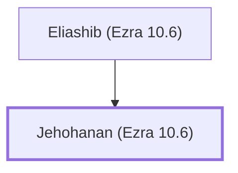

# Jehohanan (Ezra 10.6)

Son of Eliashib, a priest during Ezra's time

**Original-language names:** יְהוֹחָנָן (H3076)

## Family

- **Father:** [[connections/people/Eliashib (Ezra 10.6)|Eliashib (Ezra 10.6)]]

**Family group:** [[connections/genealogy/Family of Eliashib (Ezra 10.6)|Family of Eliashib (Ezra 10.6)]], generation 2

## Appears in

[[connections/chapters/15-ezra/Ezra 10|Ezra 10]]

## Appears in the same verse as

[[connections/people/Eliashib (Ezra 10.6)|Eliashib (Ezra 10.6)]] · [[connections/people/Ezra (Ezra 7.1)|Ezra (Ezra 7.1)]]
