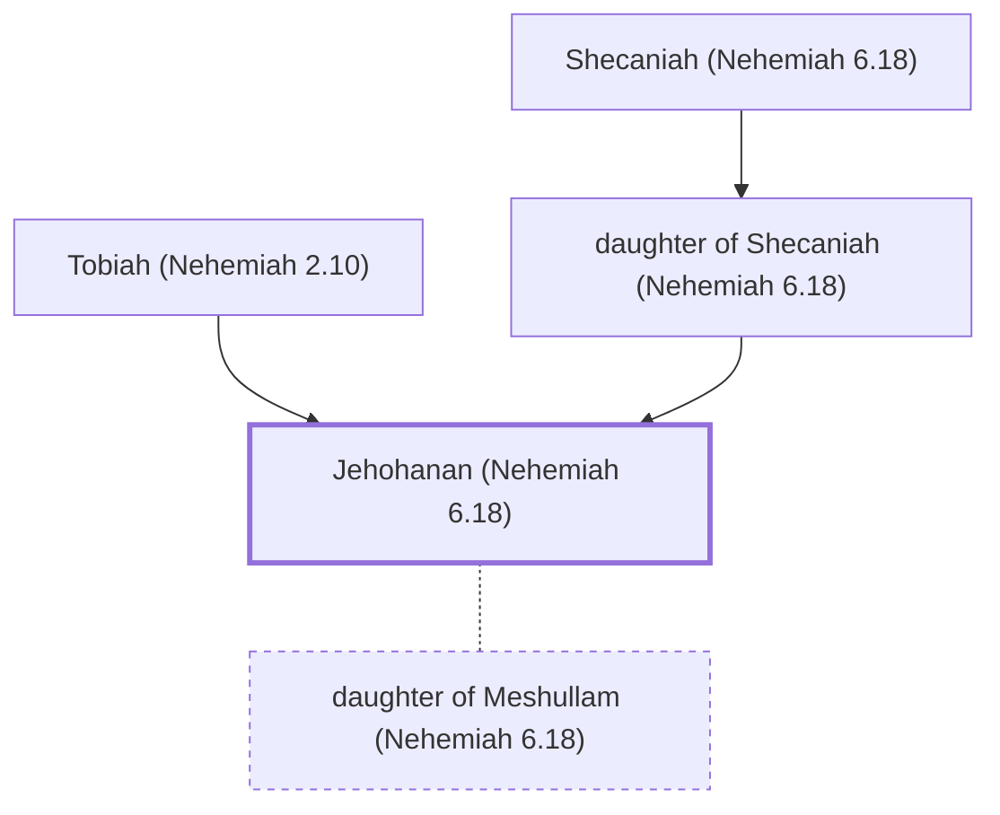

# Jehohanan (Nehemiah 6.18)

Father-in-law of Tobiah, an opponent of Nehemiah

**Original-language names:** יְהוֹחָנָן (H3076)

## When

- **Placed around:** [[connections/timeline/5th century BC|445 BC]] *(Ussher: the median date of the passages naming them)*

## Family

- **Father:** [[connections/people/Tobiah (Nehemiah 2.10)|Tobiah (Nehemiah 2.10)]]
- **Mother:** [[connections/people/daughter of Shecaniah (Nehemiah 6.18)|daughter of Shecaniah (Nehemiah 6.18)]]
- **Spouses:** [[connections/people/daughter of Meshullam (Nehemiah 6.18)|daughter of Meshullam (Nehemiah 6.18)]]
- **Tribe or nation:** Ammon

**Family group:** [[connections/genealogy/Family of Arah (Nehemiah 6.18)|Family of Arah (Nehemiah 6.18)]], generation 4

## Appears in

[[connections/chapters/16-nehemiah/Nehemiah 6|Nehemiah 6]]

## Appears in the same verse as

[[connections/people/Arah (Nehemiah 6.18)|Arah (Nehemiah 6.18)]] · [[connections/people/Berechiah (Nehemiah 3.4)|Berechiah (Nehemiah 3.4)]] · [[connections/people/Judah (Genesis 29.35)|Judah (Genesis 29.35)]] · [[connections/people/Meshullam (Nehemiah 3.4)|Meshullam (Nehemiah 3.4)]] · [[connections/people/Shecaniah (Nehemiah 6.18)|Shecaniah (Nehemiah 6.18)]]
