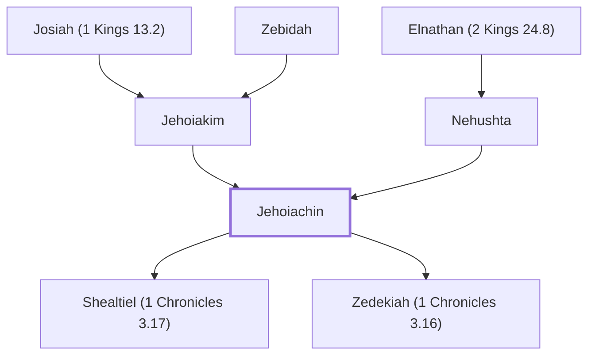

# Jehoiachin

King of Judah, son of Jehoiakim

**Also called:** Joyachin, Jeconiah, Coniah, Shallum, Jechoniah

**Original-language names:** יְהוֹיָכִין (H3078) · יוֹיָכִין (H3112) · יְכוֹנְיָה (H3204) · כׇּנְיָהוּ (H3659) · שַׁלּוּם (H7967) · Ἰεχονίας (G2423)

## When

- **Lived:** [[connections/timeline/7th century BC|616 BC]] – ? *(Jones)*
- **Placed around:** [[connections/timeline/6th century BC|598 BC]] *(Ussher: the median date of the passages naming them)*

## Family

- **Father:** [[connections/people/Jehoiakim|Jehoiakim]]
- **Mother:** [[connections/people/Nehushta|Nehushta]]
- **Children:** [[connections/people/Shealtiel (1 Chronicles 3.17)|Shealtiel (1 Chronicles 3.17) (uncertain)]], [[connections/people/Zedekiah (1 Chronicles 3.16)|Zedekiah (1 Chronicles 3.16) (uncertain)]]
- **Tribe or nation:** Tribe of Judah

**Line of descent** (52 generations, father to son): [[connections/people/Adam|Adam]] → [[connections/people/Seth|Seth]] → [[connections/people/Enosh|Enosh]] → [[connections/people/Kenan|Kenan]] → [[connections/people/Mahalalel (Genesis 5.12)|Mahalalel (Genesis 5.12)]] → [[connections/people/Jared|Jared]] → [[connections/people/Enoch (Genesis 5.18)|Enoch (Genesis 5.18)]] → [[connections/people/Methuselah|Methuselah]] → [[connections/people/Lamech (Genesis 5.25)|Lamech (Genesis 5.25)]] → [[connections/people/Noah (Genesis 5.29)|Noah (Genesis 5.29)]] → [[connections/people/Shem|Shem]] → [[connections/people/Arpachshad|Arpachshad]] → [[connections/people/Cainan|Cainan]] → [[connections/people/Shelah (Genesis 10.24)|Shelah (Genesis 10.24)]] → [[connections/people/Eber (Genesis 10.21)|Eber (Genesis 10.21)]] → [[connections/people/Peleg|Peleg]] → [[connections/people/Reu|Reu]] → [[connections/people/Serug|Serug]] → [[connections/people/Nahor (Genesis 11.22)|Nahor (Genesis 11.22)]] → [[connections/people/Terah|Terah]] → [[connections/people/Abraham|Abraham]] → [[connections/people/Isaac|Isaac]] → [[connections/people/Israel|Israel]] → [[connections/people/Judah (Genesis 29.35)|Judah (Genesis 29.35)]] → [[connections/people/Perez|Perez]] → [[connections/people/Hezron (Genesis 46.12)|Hezron (Genesis 46.12)]] → [[connections/people/Ram (Ruth 4.19)|Ram (Ruth 4.19)]] → [[connections/people/Amminadab (Exodus 6.23)|Amminadab (Exodus 6.23)]] → [[connections/people/Nahshon|Nahshon]] → [[connections/people/Salmon|Salmon]] → [[connections/people/Boaz|Boaz]] → [[connections/people/Obed (Ruth 4.17)|Obed (Ruth 4.17)]] → [[connections/people/Jesse|Jesse]] → [[connections/people/David|David]] → [[connections/people/Solomon|Solomon]] → [[connections/people/Rehoboam|Rehoboam]] → [[connections/people/Abijah (1 Kings 14.31)|Abijah (1 Kings 14.31)]] → [[connections/people/Asa (1 Kings 15.8)|Asa (1 Kings 15.8)]] → [[connections/people/Jehoshaphat (1 Kings 15.24)|Jehoshaphat (1 Kings 15.24)]] → [[connections/people/Jehoram (1 Kings 22.51)|Jehoram (1 Kings 22.51)]] → [[connections/people/Ahaziah (2 Kings 8.24)|Ahaziah (2 Kings 8.24)]] → [[connections/people/Joash (2 Kings 11.2)|Joash (2 Kings 11.2)]] → [[connections/people/Amaziah (2 Kings 12.22)|Amaziah (2 Kings 12.22)]] → [[connections/people/Uzziah (2 Kings 14.21)|Uzziah (2 Kings 14.21)]] → [[connections/people/Jotham (2 Kings 15.5)|Jotham (2 Kings 15.5)]] → [[connections/people/Ahaz (2 Kings 15.38)|Ahaz (2 Kings 15.38)]] → [[connections/people/Hezekiah (2 Kings 16.20)|Hezekiah (2 Kings 16.20)]] → [[connections/people/Manasseh (2 Kings 20.21)|Manasseh (2 Kings 20.21)]] → [[connections/people/Amon (2 Kings 21.18)|Amon (2 Kings 21.18)]] → [[connections/people/Josiah (1 Kings 13.2)|Josiah (1 Kings 13.2)]] → [[connections/people/Jehoiakim|Jehoiakim]] → **Jehoiachin**

**Family group:** [[connections/genealogy/Family of Adam|Family of Adam]], generation 52

## Events

- [[connections/timeline/6th century BC|598 BC]] · [[connections/events/Reign of Jeconiah|Reign of Jeconiah]]

## Appears in

[[connections/chapters/12-2-kings/2 Kings 24|2 Kings 24 (4)]] · [[connections/chapters/12-2-kings/2 Kings 25|2 Kings 25]] · [[connections/chapters/13-1-chronicles/1 Chronicles 3|1 Chronicles 3 (2)]] · [[connections/chapters/14-2-chronicles/2 Chronicles 36|2 Chronicles 36 (2)]] · [[connections/chapters/17-esther/Esther 2|Esther 2]] · [[connections/chapters/24-jeremiah/Jeremiah 22|Jeremiah 22 (3)]] · [[connections/chapters/24-jeremiah/Jeremiah 24|Jeremiah 24]] · [[connections/chapters/24-jeremiah/Jeremiah 27|Jeremiah 27]] · [[connections/chapters/24-jeremiah/Jeremiah 28|Jeremiah 28]] · [[connections/chapters/24-jeremiah/Jeremiah 29|Jeremiah 29]] · [[connections/chapters/24-jeremiah/Jeremiah 37|Jeremiah 37]] · [[connections/chapters/24-jeremiah/Jeremiah 52|Jeremiah 52]] · [[connections/chapters/26-ezekiel/Ezekiel 1|Ezekiel 1]] · [[connections/chapters/40-matthew/Matthew 1|Matthew 1 (2)]]

## Appears in the same verse as

[[connections/people/Judah (Genesis 29.35)|Judah (Genesis 29.35) (12)]] · [[connections/places/Babylon|Babylon (11)]] · [[connections/people/Jehoiakim|Jehoiakim (8)]] · [[connections/places/Jerusalem|Jerusalem (7)]] · [[connections/people/Nebuchadnezzar|Nebuchadnezzar (4)]] · [[connections/people/Josiah (1 Kings 13.2)|Josiah (1 Kings 13.2) (3)]] · [[connections/people/Evil-merodach|Evil-merodach (2)]] · [[connections/people/Shealtiel (1 Chronicles 3.17)|Shealtiel (1 Chronicles 3.17) (2)]] · [[connections/people/Elnathan (2 Kings 24.8)|Elnathan (2 Kings 24.8)]] · [[connections/people/Israel|Israel]] · [[connections/people/Nehushta|Nehushta]] · [[connections/people/Zedekiah (1 Chronicles 3.16)|Zedekiah (1 Chronicles 3.16)]] · [[connections/people/Zedekiah (2 Kings 24.17)|Zedekiah (2 Kings 24.17)]] · [[connections/people/Zerubbabel (1 Chronicles 3.19)|Zerubbabel (1 Chronicles 3.19)]]
