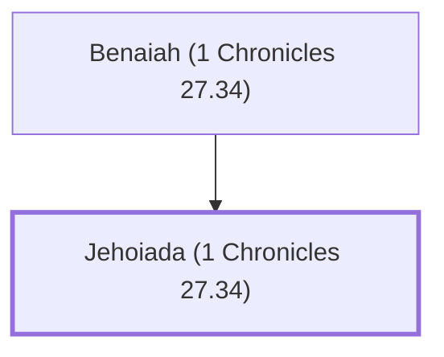

# Jehoiada (1 Chronicles 27.34)

Counselor to King David after Ahithophel

**Original-language names:** יְהוֹיָדָע (H3077)

## When

- **Placed around:** [[connections/timeline/11th century BC|1015 BC]] *(Ussher: the median date of the passages naming them)*

## Family

- **Father:** [[connections/people/Benaiah (1 Chronicles 27.34)|Benaiah (1 Chronicles 27.34)]]
- **Tribe or nation:** Tribe of Judah

**Family group:** [[connections/genealogy/Family of Benaiah (1 Chronicles 27.34)|Family of Benaiah (1 Chronicles 27.34)]], generation 2

## Appears in

[[connections/chapters/13-1-chronicles/1 Chronicles 27|1 Chronicles 27]]

## Appears in the same verse as

[[connections/people/Abiathar|Abiathar]] · [[connections/people/Ahithophel|Ahithophel]] · [[connections/people/Benaiah (1 Chronicles 27.34)|Benaiah (1 Chronicles 27.34)]] · [[connections/people/Joab (1 Samuel 26.6)|Joab (1 Samuel 26.6)]]
