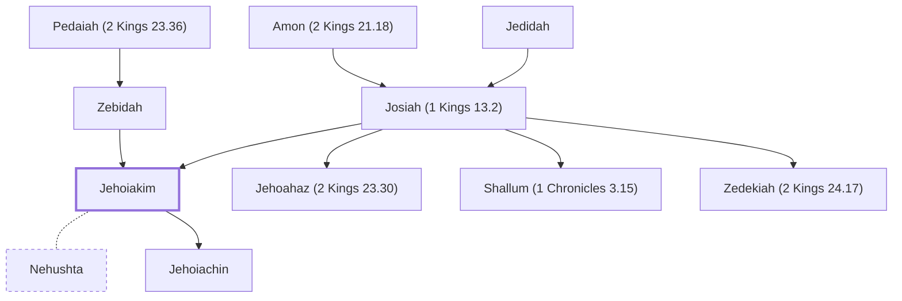

# Jehoiakim

King of Judah, son of Josiah

**Also called:** Eliakim

**Original-language names:** יְהוֹיָקִים (H3079) · אֶלְיָקִים (H0471)

## When

- **Lived:** [[connections/timeline/7th century BC|634 BC]] – [[connections/timeline/6th century BC|598 BC]] *(Jones)*
- **Placed around:** [[connections/timeline/7th century BC|606 BC]] *(Ussher: the median date of the passages naming them)*

## Family

- **Father:** [[connections/people/Josiah (1 Kings 13.2)|Josiah (1 Kings 13.2)]]
- **Mother:** [[connections/people/Zebidah|Zebidah]]
- **Brothers and sisters:** [[connections/people/Jehoahaz (2 Kings 23.30)|Jehoahaz (2 Kings 23.30)]], [[connections/people/Shallum (1 Chronicles 3.15)|Shallum (1 Chronicles 3.15)]], [[connections/people/Zedekiah (2 Kings 24.17)|Zedekiah (2 Kings 24.17)]]
- **Spouses:** [[connections/people/Nehushta|Nehushta]]
- **Children:** [[connections/people/Jehoiachin|Jehoiachin]]
- **Tribe or nation:** Tribe of Judah

**Line of descent** (51 generations, father to son): [[connections/people/Adam|Adam]] → [[connections/people/Seth|Seth]] → [[connections/people/Enosh|Enosh]] → [[connections/people/Kenan|Kenan]] → [[connections/people/Mahalalel (Genesis 5.12)|Mahalalel (Genesis 5.12)]] → [[connections/people/Jared|Jared]] → [[connections/people/Enoch (Genesis 5.18)|Enoch (Genesis 5.18)]] → [[connections/people/Methuselah|Methuselah]] → [[connections/people/Lamech (Genesis 5.25)|Lamech (Genesis 5.25)]] → [[connections/people/Noah (Genesis 5.29)|Noah (Genesis 5.29)]] → [[connections/people/Shem|Shem]] → [[connections/people/Arpachshad|Arpachshad]] → [[connections/people/Cainan|Cainan]] → [[connections/people/Shelah (Genesis 10.24)|Shelah (Genesis 10.24)]] → [[connections/people/Eber (Genesis 10.21)|Eber (Genesis 10.21)]] → [[connections/people/Peleg|Peleg]] → [[connections/people/Reu|Reu]] → [[connections/people/Serug|Serug]] → [[connections/people/Nahor (Genesis 11.22)|Nahor (Genesis 11.22)]] → [[connections/people/Terah|Terah]] → [[connections/people/Abraham|Abraham]] → [[connections/people/Isaac|Isaac]] → [[connections/people/Israel|Israel]] → [[connections/people/Judah (Genesis 29.35)|Judah (Genesis 29.35)]] → [[connections/people/Perez|Perez]] → [[connections/people/Hezron (Genesis 46.12)|Hezron (Genesis 46.12)]] → [[connections/people/Ram (Ruth 4.19)|Ram (Ruth 4.19)]] → [[connections/people/Amminadab (Exodus 6.23)|Amminadab (Exodus 6.23)]] → [[connections/people/Nahshon|Nahshon]] → [[connections/people/Salmon|Salmon]] → [[connections/people/Boaz|Boaz]] → [[connections/people/Obed (Ruth 4.17)|Obed (Ruth 4.17)]] → [[connections/people/Jesse|Jesse]] → [[connections/people/David|David]] → [[connections/people/Solomon|Solomon]] → [[connections/people/Rehoboam|Rehoboam]] → [[connections/people/Abijah (1 Kings 14.31)|Abijah (1 Kings 14.31)]] → [[connections/people/Asa (1 Kings 15.8)|Asa (1 Kings 15.8)]] → [[connections/people/Jehoshaphat (1 Kings 15.24)|Jehoshaphat (1 Kings 15.24)]] → [[connections/people/Jehoram (1 Kings 22.51)|Jehoram (1 Kings 22.51)]] → [[connections/people/Ahaziah (2 Kings 8.24)|Ahaziah (2 Kings 8.24)]] → [[connections/people/Joash (2 Kings 11.2)|Joash (2 Kings 11.2)]] → [[connections/people/Amaziah (2 Kings 12.22)|Amaziah (2 Kings 12.22)]] → [[connections/people/Uzziah (2 Kings 14.21)|Uzziah (2 Kings 14.21)]] → [[connections/people/Jotham (2 Kings 15.5)|Jotham (2 Kings 15.5)]] → [[connections/people/Ahaz (2 Kings 15.38)|Ahaz (2 Kings 15.38)]] → [[connections/people/Hezekiah (2 Kings 16.20)|Hezekiah (2 Kings 16.20)]] → [[connections/people/Manasseh (2 Kings 20.21)|Manasseh (2 Kings 20.21)]] → [[connections/people/Amon (2 Kings 21.18)|Amon (2 Kings 21.18)]] → [[connections/people/Josiah (1 Kings 13.2)|Josiah (1 Kings 13.2)]] → **Jehoiakim**

**Family group:** [[connections/genealogy/Family of Adam|Family of Adam]], generation 51

## Events

- [[connections/timeline/7th century BC|609 BC]] · [[connections/events/Reign of Jehoiakim|Reign of Jehoiakim]]

## Appears in

[[connections/chapters/12-2-kings/2 Kings 23|2 Kings 23 (3)]] · [[connections/chapters/12-2-kings/2 Kings 24|2 Kings 24 (4)]] · [[connections/chapters/13-1-chronicles/1 Chronicles 3|1 Chronicles 3 (2)]] · [[connections/chapters/14-2-chronicles/2 Chronicles 36|2 Chronicles 36 (3)]] · [[connections/chapters/24-jeremiah/Jeremiah 1|Jeremiah 1]] · [[connections/chapters/24-jeremiah/Jeremiah 22|Jeremiah 22 (2)]] · [[connections/chapters/24-jeremiah/Jeremiah 24|Jeremiah 24]] · [[connections/chapters/24-jeremiah/Jeremiah 25|Jeremiah 25]] · [[connections/chapters/24-jeremiah/Jeremiah 26|Jeremiah 26 (4)]] · [[connections/chapters/24-jeremiah/Jeremiah 27|Jeremiah 27 (2)]] · [[connections/chapters/24-jeremiah/Jeremiah 28|Jeremiah 28]] · [[connections/chapters/24-jeremiah/Jeremiah 35|Jeremiah 35]] · [[connections/chapters/24-jeremiah/Jeremiah 36|Jeremiah 36 (6)]] · [[connections/chapters/24-jeremiah/Jeremiah 37|Jeremiah 37]] · [[connections/chapters/24-jeremiah/Jeremiah 45|Jeremiah 45]] · [[connections/chapters/24-jeremiah/Jeremiah 46|Jeremiah 46]] · [[connections/chapters/24-jeremiah/Jeremiah 52|Jeremiah 52]] · [[connections/chapters/27-daniel/Daniel 1|Daniel 1 (2)]]

## Appears in the same verse as

[[connections/people/Judah (Genesis 29.35)|Judah (Genesis 29.35) (24)]] · [[connections/people/Josiah (1 Kings 13.2)|Josiah (1 Kings 13.2) (13)]] · [[connections/places/Babylon|Babylon (10)]] · [[connections/people/Jehoiachin|Jehoiachin (8)]] · [[connections/places/Jerusalem|Jerusalem (8)]] · [[connections/people/Nebuchadnezzar|Nebuchadnezzar (7)]] · [[connections/people/Jeremiah (2 Chronicles 35.25)|Jeremiah (2 Chronicles 35.25) (6)]] · [[connections/places/Egypt|Egypt (6)]] · [[connections/people/Neco|Neco (4)]] · [[connections/people/Zedekiah (2 Kings 24.17)|Zedekiah (2 Kings 24.17) (4)]] · [[connections/people/Jehoahaz (2 Kings 23.30)|Jehoahaz (2 Kings 23.30) (3)]] · [[connections/people/Baruch (Jeremiah 32.12)|Baruch (Jeremiah 32.12) (2)]] · [[connections/people/Neriah|Neriah (2)]] · [[connections/people/Uriah (Jeremiah 26.20)|Uriah (Jeremiah 26.20) (2)]] · [[connections/people/Achbor (2 Kings 22.12)|Achbor (2 Kings 22.12)]] · [[connections/people/David|David]] · [[connections/people/Elnathan (Jeremiah 26.22)|Elnathan (Jeremiah 26.22)]] · [[connections/people/Israel|Israel]] · [[connections/people/Pedaiah (2 Kings 23.36)|Pedaiah (2 Kings 23.36)]] · [[connections/people/Shallum (1 Chronicles 3.15)|Shallum (1 Chronicles 3.15)]] · [[connections/people/Zebidah|Zebidah]] · [[connections/people/Zedekiah (1 Chronicles 3.16)|Zedekiah (1 Chronicles 3.16)]] · [[connections/places/Arumah|Arumah]] · [[connections/places/Carchemish|Carchemish]] · [[connections/places/Euphrates|Euphrates]]
