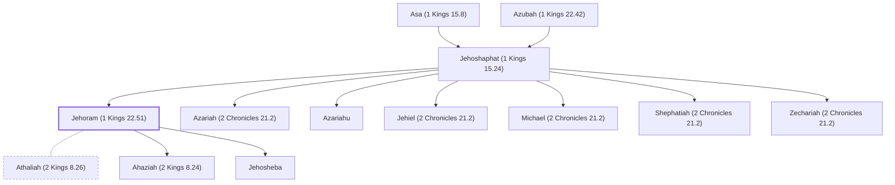

# Jehoram (1 Kings 22.51)

Son of Jehoshaphat, king of Judah.

**Also called:** Joram

**Original-language names:** יְהוֹרָם (H3088) · יוֹרָם (H3141) · Ἰωράμ (G2496)

## When

- **Lived:** [[connections/timeline/10th century BC|925 BC]] – [[connections/timeline/9th century BC|886 BC]] *(Jones)*
- **Placed around:** [[connections/timeline/9th century BC|889 BC]] *(Ussher: the median date of the passages naming them)*

## Family

- **Father:** [[connections/people/Jehoshaphat (1 Kings 15.24)|Jehoshaphat (1 Kings 15.24)]]
- **Brothers and sisters:** [[connections/people/Azariah (2 Chronicles 21.2)|Azariah (2 Chronicles 21.2)]], [[connections/people/Azariahu|Azariahu]], [[connections/people/Jehiel (2 Chronicles 21.2)|Jehiel (2 Chronicles 21.2)]], [[connections/people/Michael (2 Chronicles 21.2)|Michael (2 Chronicles 21.2)]], [[connections/people/Shephatiah (2 Chronicles 21.2)|Shephatiah (2 Chronicles 21.2)]], [[connections/people/Zechariah (2 Chronicles 21.2)|Zechariah (2 Chronicles 21.2)]]
- **Spouses:** [[connections/people/Athaliah (2 Kings 8.26)|Athaliah (2 Kings 8.26)]]
- **Children:** [[connections/people/Ahaziah (2 Kings 8.24)|Ahaziah (2 Kings 8.24)]], [[connections/people/Jehosheba|Jehosheba]]
- **Tribe or nation:** Tribe of Judah

**Line of descent** (40 generations, father to son): [[connections/people/Adam|Adam]] → [[connections/people/Seth|Seth]] → [[connections/people/Enosh|Enosh]] → [[connections/people/Kenan|Kenan]] → [[connections/people/Mahalalel (Genesis 5.12)|Mahalalel (Genesis 5.12)]] → [[connections/people/Jared|Jared]] → [[connections/people/Enoch (Genesis 5.18)|Enoch (Genesis 5.18)]] → [[connections/people/Methuselah|Methuselah]] → [[connections/people/Lamech (Genesis 5.25)|Lamech (Genesis 5.25)]] → [[connections/people/Noah (Genesis 5.29)|Noah (Genesis 5.29)]] → [[connections/people/Shem|Shem]] → [[connections/people/Arpachshad|Arpachshad]] → [[connections/people/Cainan|Cainan]] → [[connections/people/Shelah (Genesis 10.24)|Shelah (Genesis 10.24)]] → [[connections/people/Eber (Genesis 10.21)|Eber (Genesis 10.21)]] → [[connections/people/Peleg|Peleg]] → [[connections/people/Reu|Reu]] → [[connections/people/Serug|Serug]] → [[connections/people/Nahor (Genesis 11.22)|Nahor (Genesis 11.22)]] → [[connections/people/Terah|Terah]] → [[connections/people/Abraham|Abraham]] → [[connections/people/Isaac|Isaac]] → [[connections/people/Israel|Israel]] → [[connections/people/Judah (Genesis 29.35)|Judah (Genesis 29.35)]] → [[connections/people/Perez|Perez]] → [[connections/people/Hezron (Genesis 46.12)|Hezron (Genesis 46.12)]] → [[connections/people/Ram (Ruth 4.19)|Ram (Ruth 4.19)]] → [[connections/people/Amminadab (Exodus 6.23)|Amminadab (Exodus 6.23)]] → [[connections/people/Nahshon|Nahshon]] → [[connections/people/Salmon|Salmon]] → [[connections/people/Boaz|Boaz]] → [[connections/people/Obed (Ruth 4.17)|Obed (Ruth 4.17)]] → [[connections/people/Jesse|Jesse]] → [[connections/people/David|David]] → [[connections/people/Solomon|Solomon]] → [[connections/people/Rehoboam|Rehoboam]] → [[connections/people/Abijah (1 Kings 14.31)|Abijah (1 Kings 14.31)]] → [[connections/people/Asa (1 Kings 15.8)|Asa (1 Kings 15.8)]] → [[connections/people/Jehoshaphat (1 Kings 15.24)|Jehoshaphat (1 Kings 15.24)]] → **Jehoram (1 Kings 22.51)**

**Family group:** [[connections/genealogy/Family of Adam|Family of Adam]], generation 40

## Events

- [[connections/timeline/9th century BC|893 BC]] · [[connections/events/Reign of Jehoram|Reign of Jehoram]]
- [[connections/timeline/9th century BC|886 BC]] · [[connections/events/Death of Jehoram|Death of Jehoram]]

## Appears in

[[connections/chapters/11-1-kings/1 Kings 22|1 Kings 22]] · [[connections/chapters/12-2-kings/2 Kings 1|2 Kings 1]] · [[connections/chapters/12-2-kings/2 Kings 8|2 Kings 8 (6)]] · [[connections/chapters/12-2-kings/2 Kings 11|2 Kings 11]] · [[connections/chapters/12-2-kings/2 Kings 12|2 Kings 12]] · [[connections/chapters/13-1-chronicles/1 Chronicles 3|1 Chronicles 3]] · [[connections/chapters/14-2-chronicles/2 Chronicles 21|2 Chronicles 21 (6)]] · [[connections/chapters/14-2-chronicles/2 Chronicles 22|2 Chronicles 22 (3)]] · [[connections/chapters/40-matthew/Matthew 1|Matthew 1]]

## Appears in the same verse as

[[connections/people/Ahaziah (2 Kings 8.24)|Ahaziah (2 Kings 8.24) (9)]] · [[connections/people/Judah (Genesis 29.35)|Judah (Genesis 29.35) (9)]] · [[connections/people/Jehoshaphat (1 Kings 15.24)|Jehoshaphat (1 Kings 15.24) (6)]] · [[connections/people/Joram (2 Kings 1.17)|Joram (2 Kings 1.17) (5)]] · [[connections/people/Ahab (1 Kings 16.28)|Ahab (1 Kings 16.28) (4)]] · [[connections/people/Joash (2 Kings 11.2)|Joash (2 Kings 11.2) (4)]] · [[connections/people/David|David (3)]] · [[connections/people/Hazael|Hazael (3)]] · [[connections/people/Israel|Israel (3)]] · [[connections/places/Jerusalem|Jerusalem (3)]] · [[connections/places/Syria|Syria (3)]] · [[connections/people/Athaliah (2 Kings 8.26)|Athaliah (2 Kings 8.26) (2)]] · [[connections/people/Jehosheba|Jehosheba (2)]] · [[connections/places/Edom|Edom (2)]] · [[connections/places/Jezreel (Joshua 19.18)|Jezreel (Joshua 19.18) (2)]] · [[connections/places/Ramoth|Ramoth (2)]] · [[connections/people/Asa (1 Kings 15.8)|Asa (1 Kings 15.8)]] · [[connections/people/Elijah (1 Kings 17.1)|Elijah (1 Kings 17.1)]] · [[connections/people/Jehoiada (2 Kings 11.4)|Jehoiada (2 Kings 11.4)]] · [[connections/people/Uzziah (2 Kings 14.21)|Uzziah (2 Kings 14.21)]] · [[connections/places/Zoar|Zoar]]
