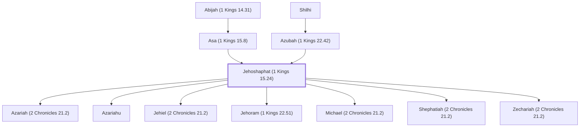

# Jehoshaphat (1 Kings 15.24)

Son of Asa, king of Judah.

**Original-language names:** יְהוֹשָׁפָט (H3092) · Ἰωσαφάτ (G2498)

## When

- **Lived:** [[connections/timeline/10th century BC|950 BC]] – [[connections/timeline/9th century BC|889 BC]] *(Jones)*
- **Placed around:** [[connections/timeline/9th century BC|897 BC]] *(Ussher: the median date of the passages naming them)*

## Family

- **Father:** [[connections/people/Asa (1 Kings 15.8)|Asa (1 Kings 15.8)]]
- **Mother:** [[connections/people/Azubah (1 Kings 22.42)|Azubah (1 Kings 22.42)]]
- **Children:** [[connections/people/Azariah (2 Chronicles 21.2)|Azariah (2 Chronicles 21.2)]], [[connections/people/Azariahu|Azariahu]], [[connections/people/Jehiel (2 Chronicles 21.2)|Jehiel (2 Chronicles 21.2)]], [[connections/people/Jehoram (1 Kings 22.51)|Jehoram (1 Kings 22.51)]], [[connections/people/Michael (2 Chronicles 21.2)|Michael (2 Chronicles 21.2)]], [[connections/people/Shephatiah (2 Chronicles 21.2)|Shephatiah (2 Chronicles 21.2)]], [[connections/people/Zechariah (2 Chronicles 21.2)|Zechariah (2 Chronicles 21.2)]]
- **Tribe or nation:** Tribe of Judah

**Line of descent** (39 generations, father to son): [[connections/people/Adam|Adam]] → [[connections/people/Seth|Seth]] → [[connections/people/Enosh|Enosh]] → [[connections/people/Kenan|Kenan]] → [[connections/people/Mahalalel (Genesis 5.12)|Mahalalel (Genesis 5.12)]] → [[connections/people/Jared|Jared]] → [[connections/people/Enoch (Genesis 5.18)|Enoch (Genesis 5.18)]] → [[connections/people/Methuselah|Methuselah]] → [[connections/people/Lamech (Genesis 5.25)|Lamech (Genesis 5.25)]] → [[connections/people/Noah (Genesis 5.29)|Noah (Genesis 5.29)]] → [[connections/people/Shem|Shem]] → [[connections/people/Arpachshad|Arpachshad]] → [[connections/people/Cainan|Cainan]] → [[connections/people/Shelah (Genesis 10.24)|Shelah (Genesis 10.24)]] → [[connections/people/Eber (Genesis 10.21)|Eber (Genesis 10.21)]] → [[connections/people/Peleg|Peleg]] → [[connections/people/Reu|Reu]] → [[connections/people/Serug|Serug]] → [[connections/people/Nahor (Genesis 11.22)|Nahor (Genesis 11.22)]] → [[connections/people/Terah|Terah]] → [[connections/people/Abraham|Abraham]] → [[connections/people/Isaac|Isaac]] → [[connections/people/Israel|Israel]] → [[connections/people/Judah (Genesis 29.35)|Judah (Genesis 29.35)]] → [[connections/people/Perez|Perez]] → [[connections/people/Hezron (Genesis 46.12)|Hezron (Genesis 46.12)]] → [[connections/people/Ram (Ruth 4.19)|Ram (Ruth 4.19)]] → [[connections/people/Amminadab (Exodus 6.23)|Amminadab (Exodus 6.23)]] → [[connections/people/Nahshon|Nahshon]] → [[connections/people/Salmon|Salmon]] → [[connections/people/Boaz|Boaz]] → [[connections/people/Obed (Ruth 4.17)|Obed (Ruth 4.17)]] → [[connections/people/Jesse|Jesse]] → [[connections/people/David|David]] → [[connections/people/Solomon|Solomon]] → [[connections/people/Rehoboam|Rehoboam]] → [[connections/people/Abijah (1 Kings 14.31)|Abijah (1 Kings 14.31)]] → [[connections/people/Asa (1 Kings 15.8)|Asa (1 Kings 15.8)]] → **Jehoshaphat (1 Kings 15.24)**

**Family group:** [[connections/genealogy/Family of Adam|Family of Adam]], generation 39

## Events

- [[connections/timeline/10th century BC|914 BC]] · [[connections/events/Reign of Jehoshaphat|Reign of Jehoshaphat]]
- [[connections/timeline/9th century BC|889 BC]] · [[connections/events/Death of Jehoshaphat|Death of Jehoshaphat]]

## Appears in

[[connections/chapters/11-1-kings/1 Kings 15|1 Kings 15]] · [[connections/chapters/11-1-kings/1 Kings 22|1 Kings 22 (18)]] · [[connections/chapters/12-2-kings/2 Kings 1|2 Kings 1]] · [[connections/chapters/12-2-kings/2 Kings 3|2 Kings 3 (5)]] · [[connections/chapters/12-2-kings/2 Kings 8|2 Kings 8]] · [[connections/chapters/12-2-kings/2 Kings 12|2 Kings 12]] · [[connections/chapters/13-1-chronicles/1 Chronicles 3|1 Chronicles 3]] · [[connections/chapters/14-2-chronicles/2 Chronicles 17|2 Chronicles 17 (6)]] · [[connections/chapters/14-2-chronicles/2 Chronicles 18|2 Chronicles 18 (10)]] · [[connections/chapters/14-2-chronicles/2 Chronicles 19|2 Chronicles 19 (4)]] · [[connections/chapters/14-2-chronicles/2 Chronicles 20|2 Chronicles 20 (14)]] · [[connections/chapters/14-2-chronicles/2 Chronicles 21|2 Chronicles 21 (3)]] · [[connections/chapters/14-2-chronicles/2 Chronicles 22|2 Chronicles 22]] · [[connections/chapters/40-matthew/Matthew 1|Matthew 1]]

## Appears in the same verse as

[[connections/people/Israel|Israel (29)]] · [[connections/people/Judah (Genesis 29.35)|Judah (Genesis 29.35) (28)]] · [[connections/places/Jerusalem|Jerusalem (11)]] · [[connections/people/Ahab (1 Kings 16.28)|Ahab (1 Kings 16.28) (7)]] · [[connections/people/Jehoram (1 Kings 22.51)|Jehoram (1 Kings 22.51) (6)]] · [[connections/people/Asa (1 Kings 15.8)|Asa (1 Kings 15.8) (5)]] · [[connections/people/David|David (5)]] · [[connections/places/Samaria|Samaria (5)]] · [[connections/people/Ahaziah (1 Kings 22.40)|Ahaziah (1 Kings 22.40) (4)]] · [[connections/places/Ramoth|Ramoth (4)]] · [[connections/people/Elijah (1 Kings 17.1)|Elijah (1 Kings 17.1) (3)]] · [[connections/people/Joram (2 Kings 1.17)|Joram (2 Kings 1.17) (3)]] · [[connections/people/Ahaziah (2 Kings 8.24)|Ahaziah (2 Kings 8.24) (2)]] · [[connections/people/Azubah (1 Kings 22.42)|Azubah (1 Kings 22.42) (2)]] · [[connections/people/Elisha|Elisha (2)]] · [[connections/people/Hanani (1 Kings 16.1)|Hanani (1 Kings 16.1) (2)]] · [[connections/people/Imlah|Imlah (2)]] · [[connections/people/Jehu (1 Kings 16.1)|Jehu (1 Kings 16.1) (2)]] · [[connections/people/Micaiah (1 Kings 22.8)|Micaiah (1 Kings 22.8) (2)]] · [[connections/people/Shilhi|Shilhi (2)]] · [[connections/places/Edom|Edom (2)]] · [[connections/places/Moab|Moab (2)]] · [[connections/places/Tarshish|Tarshish (2)]] · [[connections/people/Abijah (1 Kings 14.31)|Abijah (1 Kings 14.31)]] · [[connections/people/Azariah (2 Chronicles 21.2)|Azariah (2 Chronicles 21.2)]] · [[connections/people/Azariahu|Azariahu]] · [[connections/people/Dodavahu|Dodavahu]] · [[connections/people/Eliezer (2 Chronicles 20.37)|Eliezer (2 Chronicles 20.37)]] · [[connections/people/Ephraim|Ephraim]] · [[connections/people/Hazael|Hazael]] · [[connections/people/Jehiel (2 Chronicles 21.2)|Jehiel (2 Chronicles 21.2)]] · [[connections/people/Jehu (1 Kings 19.16)|Jehu (1 Kings 19.16)]] · [[connections/people/Joash (2 Kings 11.2)|Joash (2 Kings 11.2)]] · [[connections/people/Michael (2 Chronicles 21.2)|Michael (2 Chronicles 21.2)]] · [[connections/people/Rehoboam|Rehoboam]] · [[connections/people/Shaphat (1 Kings 19.16)|Shaphat (1 Kings 19.16)]] · [[connections/people/Shephatiah (2 Chronicles 21.2)|Shephatiah (2 Chronicles 21.2)]] · [[connections/people/Solomon|Solomon]] · [[connections/people/Uzziah (2 Kings 14.21)|Uzziah (2 Kings 14.21)]] · [[connections/people/Zechariah (2 Chronicles 21.2)|Zechariah (2 Chronicles 21.2)]] · [[connections/places/Ammon|Ammon]] · [[connections/places/Beersheba|Beersheba]] · [[connections/places/Engedi|Engedi]] · [[connections/places/Ezion-geber|Ezion-geber]] · [[connections/places/Mareshah|Mareshah]] · [[connections/places/Ophir|Ophir]] · [[connections/places/Syria|Syria]] · [[connections/places/Tekoa|Tekoa]]
