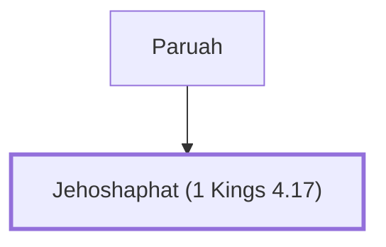

# Jehoshaphat (1 Kings 4.17)

Solomon's officer, son of Paruah.

**Original-language names:** יְהוֹשָׁפָט (H3092)

## When

- **Placed around:** [[connections/timeline/11th century BC|1014 BC]] *(Ussher: the median date of the passages naming them)*

## Family

- **Father:** [[connections/people/Paruah|Paruah]]

**Family group:** [[connections/genealogy/Family of Paruah|Family of Paruah]], generation 2

## Appears in

[[connections/chapters/11-1-kings/1 Kings 4|1 Kings 4]]

## Appears in the same verse as

[[connections/people/Issachar (Genesis 30.18)|Issachar (Genesis 30.18)]] · [[connections/people/Paruah|Paruah]]
