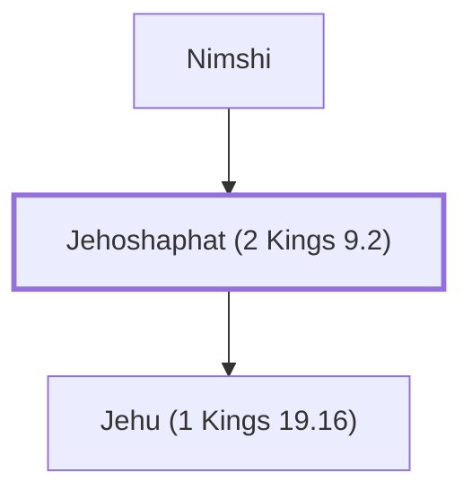

# Jehoshaphat (2 Kings 9.2)

Father of Jehu, king of Israel.

**Original-language names:** יְהוֹשָׁפָט (H3092)

## When

- **Placed around:** [[connections/timeline/9th century BC|884 BC]] *(Ussher: the median date of the passages naming them)*

## Family

- **Father:** [[connections/people/Nimshi|Nimshi]]
- **Children:** [[connections/people/Jehu (1 Kings 19.16)|Jehu (1 Kings 19.16)]]
- **Tribe or nation:** Israel

**Family group:** [[connections/genealogy/Family of Nimshi|Family of Nimshi]], generation 2

## Appears in

[[connections/chapters/12-2-kings/2 Kings 9|2 Kings 9 (2)]]

## Appears in the same verse as

[[connections/people/Jehu (1 Kings 19.16)|Jehu (1 Kings 19.16) (2)]] · [[connections/people/Nimshi|Nimshi (2)]] · [[connections/people/Hazael|Hazael]] · [[connections/people/Israel|Israel]] · [[connections/people/Joram (2 Kings 1.17)|Joram (2 Kings 1.17)]] · [[connections/places/Ramoth|Ramoth]] · [[connections/places/Syria|Syria]]
