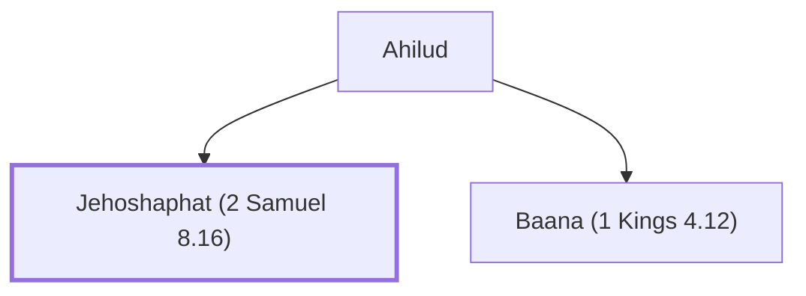

# Jehoshaphat (2 Samuel 8.16)

Recorder for David and Solomon.

**Original-language names:** יְהוֹשָׁפָט (H3092)

## When

- **Placed around:** [[connections/timeline/11th century BC|1022 BC]] *(Ussher: the median date of the passages naming them)*

## Family

- **Father:** [[connections/people/Ahilud|Ahilud]]
- **Brothers and sisters:** [[connections/people/Baana (1 Kings 4.12)|Baana (1 Kings 4.12)]]

**Family group:** [[connections/genealogy/Family of Ahilud|Family of Ahilud]], generation 2

## Appears in

[[connections/chapters/10-2-samuel/2 Samuel 8|2 Samuel 8]] · [[connections/chapters/10-2-samuel/2 Samuel 20|2 Samuel 20]] · [[connections/chapters/11-1-kings/1 Kings 4|1 Kings 4]] · [[connections/chapters/13-1-chronicles/1 Chronicles 18|1 Chronicles 18]]

## Appears in the same verse as

[[connections/people/Ahilud|Ahilud (4)]] · [[connections/people/Joab (1 Samuel 26.6)|Joab (1 Samuel 26.6) (2)]] · [[connections/people/Zeruiah|Zeruiah (2)]] · [[connections/people/Adoram|Adoram]] · [[connections/people/Ahijah (1 Kings 4.3)|Ahijah (1 Kings 4.3)]] · [[connections/people/Elihoreph|Elihoreph]] · [[connections/people/Seraiah (2 Samuel 8.17)|Seraiah (2 Samuel 8.17)]]
