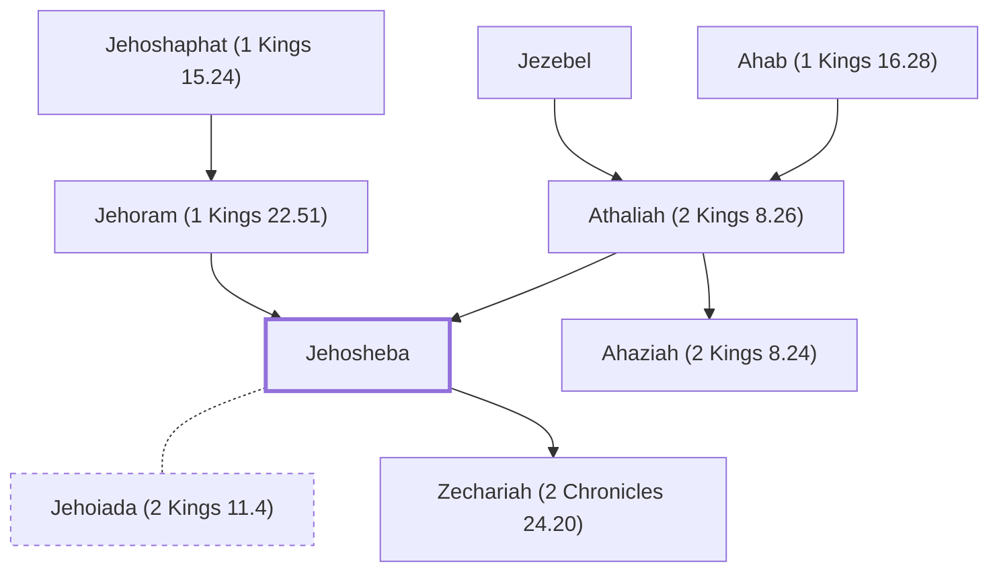

# Jehosheba

Daughter of Jehoram, saved Joash from Athaliah's massacre.

**Also called:** Jehoshabeath

**Original-language names:** יְהוֹשֶׁבַע (H3089) · יְהוֹשַׁבְעַת (H3090)

## When

- **Placed around:** [[connections/timeline/9th century BC|884 BC]] *(Ussher: the median date of the passages naming them)*

## Family

- **Father:** [[connections/people/Jehoram (1 Kings 22.51)|Jehoram (1 Kings 22.51)]]
- **Mother:** [[connections/people/Athaliah (2 Kings 8.26)|Athaliah (2 Kings 8.26)]]
- **Brothers and sisters:** [[connections/people/Ahaziah (2 Kings 8.24)|Ahaziah (2 Kings 8.24)]]
- **Spouses:** [[connections/people/Jehoiada (2 Kings 11.4)|Jehoiada (2 Kings 11.4)]]
- **Children:** [[connections/people/Zechariah (2 Chronicles 24.20)|Zechariah (2 Chronicles 24.20)]]
- **Tribe or nation:** Tribe of Judah

**Line of descent** (41 generations, father to son): [[connections/people/Adam|Adam]] → [[connections/people/Seth|Seth]] → [[connections/people/Enosh|Enosh]] → [[connections/people/Kenan|Kenan]] → [[connections/people/Mahalalel (Genesis 5.12)|Mahalalel (Genesis 5.12)]] → [[connections/people/Jared|Jared]] → [[connections/people/Enoch (Genesis 5.18)|Enoch (Genesis 5.18)]] → [[connections/people/Methuselah|Methuselah]] → [[connections/people/Lamech (Genesis 5.25)|Lamech (Genesis 5.25)]] → [[connections/people/Noah (Genesis 5.29)|Noah (Genesis 5.29)]] → [[connections/people/Shem|Shem]] → [[connections/people/Arpachshad|Arpachshad]] → [[connections/people/Cainan|Cainan]] → [[connections/people/Shelah (Genesis 10.24)|Shelah (Genesis 10.24)]] → [[connections/people/Eber (Genesis 10.21)|Eber (Genesis 10.21)]] → [[connections/people/Peleg|Peleg]] → [[connections/people/Reu|Reu]] → [[connections/people/Serug|Serug]] → [[connections/people/Nahor (Genesis 11.22)|Nahor (Genesis 11.22)]] → [[connections/people/Terah|Terah]] → [[connections/people/Abraham|Abraham]] → [[connections/people/Isaac|Isaac]] → [[connections/people/Israel|Israel]] → [[connections/people/Judah (Genesis 29.35)|Judah (Genesis 29.35)]] → [[connections/people/Perez|Perez]] → [[connections/people/Hezron (Genesis 46.12)|Hezron (Genesis 46.12)]] → [[connections/people/Ram (Ruth 4.19)|Ram (Ruth 4.19)]] → [[connections/people/Amminadab (Exodus 6.23)|Amminadab (Exodus 6.23)]] → [[connections/people/Nahshon|Nahshon]] → [[connections/people/Salmon|Salmon]] → [[connections/people/Boaz|Boaz]] → [[connections/people/Obed (Ruth 4.17)|Obed (Ruth 4.17)]] → [[connections/people/Jesse|Jesse]] → [[connections/people/David|David]] → [[connections/people/Solomon|Solomon]] → [[connections/people/Rehoboam|Rehoboam]] → [[connections/people/Abijah (1 Kings 14.31)|Abijah (1 Kings 14.31)]] → [[connections/people/Asa (1 Kings 15.8)|Asa (1 Kings 15.8)]] → [[connections/people/Jehoshaphat (1 Kings 15.24)|Jehoshaphat (1 Kings 15.24)]] → [[connections/people/Jehoram (1 Kings 22.51)|Jehoram (1 Kings 22.51)]] → **Jehosheba**

**Family group:** [[connections/genealogy/Family of Adam|Family of Adam]], generation 41

## Appears in

[[connections/chapters/12-2-kings/2 Kings 11|2 Kings 11]] · [[connections/chapters/14-2-chronicles/2 Chronicles 22|2 Chronicles 22]]

## Appears in the same verse as

[[connections/people/Ahaziah (2 Kings 8.24)|Ahaziah (2 Kings 8.24) (2)]] · [[connections/people/Athaliah (2 Kings 8.26)|Athaliah (2 Kings 8.26) (2)]] · [[connections/people/Jehoram (1 Kings 22.51)|Jehoram (1 Kings 22.51) (2)]] · [[connections/people/Joash (2 Kings 11.2)|Joash (2 Kings 11.2) (2)]] · [[connections/people/Jehoiada (2 Kings 11.4)|Jehoiada (2 Kings 11.4)]]
