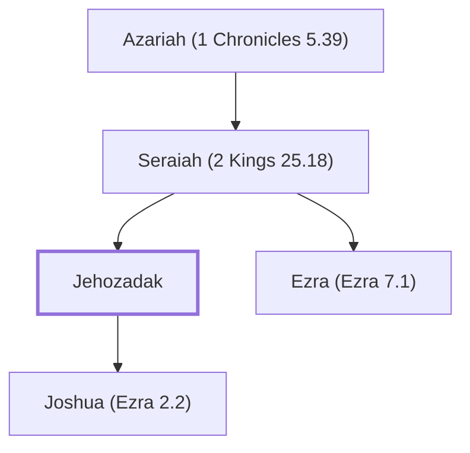

# Jehozadak

Father of Joshua the high priest during the exile.

**Also called:** Jozadak

**Original-language names:** יְהוֹצָדָק (H3087) · יוֹצָדָק (H3136a) · יוֹצָדָק (H3136b)

## When

- **Placed around:** [[connections/timeline/6th century BC|520 BC]] *(Ussher: the median date of the passages naming them)*

## Family

- **Father:** [[connections/people/Seraiah (2 Kings 25.18)|Seraiah (2 Kings 25.18)]]
- **Brothers and sisters:** [[connections/people/Ezra (Ezra 7.1)|Ezra (Ezra 7.1)]]
- **Children:** [[connections/people/Joshua (Ezra 2.2)|Joshua (Ezra 2.2)]]
- **Tribe or nation:** Tribe of Levi

**Line of descent** (49 generations, father to son): [[connections/people/Adam|Adam]] → [[connections/people/Seth|Seth]] → [[connections/people/Enosh|Enosh]] → [[connections/people/Kenan|Kenan]] → [[connections/people/Mahalalel (Genesis 5.12)|Mahalalel (Genesis 5.12)]] → [[connections/people/Jared|Jared]] → [[connections/people/Enoch (Genesis 5.18)|Enoch (Genesis 5.18)]] → [[connections/people/Methuselah|Methuselah]] → [[connections/people/Lamech (Genesis 5.25)|Lamech (Genesis 5.25)]] → [[connections/people/Noah (Genesis 5.29)|Noah (Genesis 5.29)]] → [[connections/people/Shem|Shem]] → [[connections/people/Arpachshad|Arpachshad]] → [[connections/people/Cainan|Cainan]] → [[connections/people/Shelah (Genesis 10.24)|Shelah (Genesis 10.24)]] → [[connections/people/Eber (Genesis 10.21)|Eber (Genesis 10.21)]] → [[connections/people/Peleg|Peleg]] → [[connections/people/Reu|Reu]] → [[connections/people/Serug|Serug]] → [[connections/people/Nahor (Genesis 11.22)|Nahor (Genesis 11.22)]] → [[connections/people/Terah|Terah]] → [[connections/people/Abraham|Abraham]] → [[connections/people/Isaac|Isaac]] → [[connections/people/Israel|Israel]] → [[connections/people/Levi (Genesis 29.34)|Levi (Genesis 29.34)]] → [[connections/people/Kohath|Kohath]] → [[connections/people/Amram (Exodus 6.18)|Amram (Exodus 6.18)]] → [[connections/people/Aaron|Aaron]] → [[connections/people/Eleazar (Exodus 6.23)|Eleazar (Exodus 6.23)]] → [[connections/people/Phinehas (Exodus 6.25)|Phinehas (Exodus 6.25)]] → [[connections/people/Abishua (1 Chronicles 5.30)|Abishua (1 Chronicles 5.30)]] → [[connections/people/Bukki (1 Chronicles 5.31)|Bukki (1 Chronicles 5.31)]] → [[connections/people/Uzzi (1 Chronicles 5.31)|Uzzi (1 Chronicles 5.31)]] → [[connections/people/Zerahiah (1 Chronicles 5.32)|Zerahiah (1 Chronicles 5.32)]] → [[connections/people/Meraioth|Meraioth]] → [[connections/people/Amariah (1 Chronicles 5.33)|Amariah (1 Chronicles 5.33)]] → [[connections/people/Ahitub (2 Samuel 8.17)|Ahitub (2 Samuel 8.17)]] → [[connections/people/Zadok (2 Samuel 8.17)|Zadok (2 Samuel 8.17)]] → [[connections/people/Ahimaaz (2 Samuel 15.27)|Ahimaaz (2 Samuel 15.27)]] → [[connections/people/Azariah (1 Kings 4.2)|Azariah (1 Kings 4.2)]] → [[connections/people/Johanan (1 Chronicles 5.35)|Johanan (1 Chronicles 5.35)]] → [[connections/people/Azariah (1 Chronicles 5.36)|Azariah (1 Chronicles 5.36)]] → [[connections/people/Amariah (1 Chronicles 5.37)|Amariah (1 Chronicles 5.37)]] → [[connections/people/Ahitub (1 Chronicles 5.37)|Ahitub (1 Chronicles 5.37)]] → [[connections/people/Zadok (1 Chronicles 5.38)|Zadok (1 Chronicles 5.38)]] → [[connections/people/Shallum (1 Chronicles 5.38)|Shallum (1 Chronicles 5.38)]] → [[connections/people/Hilkiah (2 Kings 22.4)|Hilkiah (2 Kings 22.4)]] → [[connections/people/Azariah (1 Chronicles 5.39)|Azariah (1 Chronicles 5.39)]] → [[connections/people/Seraiah (2 Kings 25.18)|Seraiah (2 Kings 25.18)]] → **Jehozadak**

**Family group:** [[connections/genealogy/Family of Adam|Family of Adam]], generation 49

## Appears in

[[connections/chapters/13-1-chronicles/1 Chronicles 5|1 Chronicles 5 (2)]] · [[connections/chapters/15-ezra/Ezra 3|Ezra 3 (2)]] · [[connections/chapters/15-ezra/Ezra 5|Ezra 5]] · [[connections/chapters/16-nehemiah/Nehemiah 12|Nehemiah 12]] · [[connections/chapters/37-haggai/Haggai 1|Haggai 1 (3)]] · [[connections/chapters/37-haggai/Haggai 2|Haggai 2 (2)]] · [[connections/chapters/38-zechariah/Zechariah 6|Zechariah 6]]

## Appears in the same verse as

[[connections/people/Joshua (Ezra 2.2)|Joshua (Ezra 2.2) (10)]] · [[connections/people/Zerubbabel (1 Chronicles 3.19)|Zerubbabel (1 Chronicles 3.19) (8)]] · [[connections/people/Shealtiel (1 Chronicles 3.17)|Shealtiel (1 Chronicles 3.17) (7)]] · [[connections/people/Judah (Genesis 29.35)|Judah (Genesis 29.35) (4)]] · [[connections/places/Jerusalem|Jerusalem (3)]] · [[connections/people/Haggai|Haggai (2)]] · [[connections/people/Azariah (1 Chronicles 5.39)|Azariah (1 Chronicles 5.39)]] · [[connections/people/Darius (Ezra 4.5)|Darius (Ezra 4.5)]] · [[connections/people/Ezra (Ezra 7.1)|Ezra (Ezra 7.1)]] · [[connections/people/Israel|Israel]] · [[connections/people/Joiakim|Joiakim]] · [[connections/people/Moses|Moses]] · [[connections/people/Nebuchadnezzar|Nebuchadnezzar]] · [[connections/people/Nehemiah (Nehemiah 1.1)|Nehemiah (Nehemiah 1.1)]] · [[connections/people/Seraiah (2 Kings 25.18)|Seraiah (2 Kings 25.18)]]
