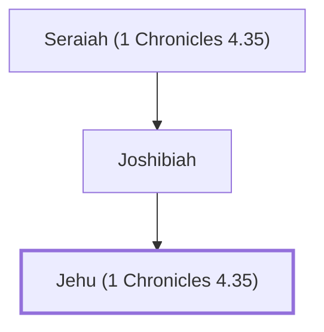

# Jehu (1 Chronicles 4.35)

Son of Joshibiah, a descendant of Simeon.

**Original-language names:** יֵהוּא (H3058)

## When

- **Placed around:** [[connections/timeline/18th century BC|1721 BC]] *(Ussher: the median date of the passages naming them)*

## Family

- **Father:** [[connections/people/Joshibiah|Joshibiah]]
- **Tribe or nation:** Tribe of Simeon

**Line of descent** (4 generations, father to son): [[connections/people/Asiel|Asiel]] → [[connections/people/Seraiah (1 Chronicles 4.35)|Seraiah (1 Chronicles 4.35)]] → [[connections/people/Joshibiah|Joshibiah]] → **Jehu (1 Chronicles 4.35)**

**Family group:** [[connections/genealogy/Family of Asiel|Family of Asiel]], generation 4

## Appears in

[[connections/chapters/13-1-chronicles/1 Chronicles 4|1 Chronicles 4]]

## Appears in the same verse as

[[connections/people/Asiel|Asiel]] · [[connections/people/Joel (1 Chronicles 4.35)|Joel (1 Chronicles 4.35)]] · [[connections/people/Joshibiah|Joshibiah]] · [[connections/people/Seraiah (1 Chronicles 4.35)|Seraiah (1 Chronicles 4.35)]]
