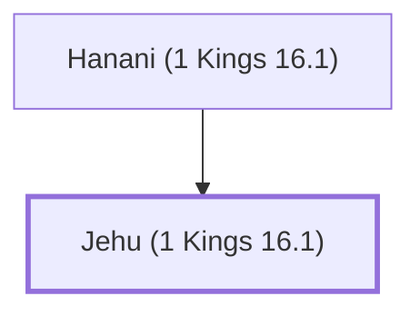

# Jehu (1 Kings 16.1)

Son of Hanani, prophet during the reign of Baasha and Jehoshaphat.

**Original-language names:** יֵהוּא (H3058)

## When

- **Placed around:** [[connections/timeline/10th century BC|929 BC]] *(Ussher: the median date of the passages naming them)*

## Family

- **Father:** [[connections/people/Hanani (1 Kings 16.1)|Hanani (1 Kings 16.1)]]

**Family group:** [[connections/genealogy/Family of Hanani (1 Kings 16.1)|Family of Hanani (1 Kings 16.1)]], generation 2

## Appears in

[[connections/chapters/11-1-kings/1 Kings 16|1 Kings 16 (3)]] · [[connections/chapters/14-2-chronicles/2 Chronicles 19|2 Chronicles 19]] · [[connections/chapters/14-2-chronicles/2 Chronicles 20|2 Chronicles 20]]

## Appears in the same verse as

[[connections/people/Hanani (1 Kings 16.1)|Hanani (1 Kings 16.1) (4)]] · [[connections/people/Baasha|Baasha (3)]] · [[connections/people/Jehoshaphat (1 Kings 15.24)|Jehoshaphat (1 Kings 15.24) (2)]] · [[connections/people/Israel|Israel]] · [[connections/people/Jeroboam (1 Kings 11.26)|Jeroboam (1 Kings 11.26)]] · [[connections/people/Zimri (1 Kings 16.9)|Zimri (1 Kings 16.9)]]
