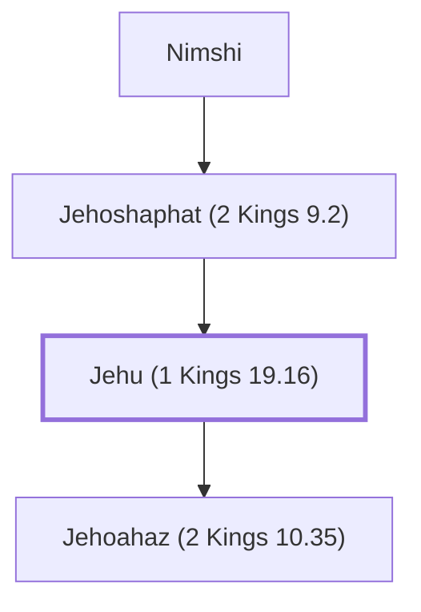

# Jehu (1 Kings 19.16)

Son of Jehoshaphat, king of Israel, destroyed Ahab's dynasty.

**Original-language names:** יֵהוּא (H3058)

## When

- **Placed around:** [[connections/timeline/9th century BC|884 BC]] *(Ussher: the median date of the passages naming them)*

## Family

- **Father:** [[connections/people/Jehoshaphat (2 Kings 9.2)|Jehoshaphat (2 Kings 9.2)]]
- **Children:** [[connections/people/Jehoahaz (2 Kings 10.35)|Jehoahaz (2 Kings 10.35)]]
- **Tribe or nation:** Israel

**Line of descent** (3 generations, father to son): [[connections/people/Nimshi|Nimshi]] → [[connections/people/Jehoshaphat (2 Kings 9.2)|Jehoshaphat (2 Kings 9.2)]] → **Jehu (1 Kings 19.16)**

**Family group:** [[connections/genealogy/Family of Nimshi|Family of Nimshi]], generation 3

## Events

- [[connections/timeline/9th century BC|886 BC]] · [[connections/events/Reign of Jehu|Reign of Jehu]]
- [[connections/timeline/9th century BC|857 BC]] · [[connections/events/Death of Jehu|Death of Jehu]]

## Appears in

[[connections/chapters/11-1-kings/1 Kings 19|1 Kings 19 (2)]] · [[connections/chapters/12-2-kings/2 Kings 9|2 Kings 9 (17)]] · [[connections/chapters/12-2-kings/2 Kings 10|2 Kings 10 (18)]] · [[connections/chapters/12-2-kings/2 Kings 12|2 Kings 12]] · [[connections/chapters/12-2-kings/2 Kings 13|2 Kings 13]] · [[connections/chapters/12-2-kings/2 Kings 14|2 Kings 14]] · [[connections/chapters/12-2-kings/2 Kings 15|2 Kings 15]] · [[connections/chapters/14-2-chronicles/2 Chronicles 22|2 Chronicles 22 (3)]] · [[connections/chapters/14-2-chronicles/2 Chronicles 25|2 Chronicles 25]] · [[connections/chapters/28-hosea/Hosea 1|Hosea 1]]

## Appears in the same verse as

[[connections/people/Israel|Israel (15)]] · [[connections/people/Ahaziah (2 Kings 8.24)|Ahaziah (2 Kings 8.24) (8)]] · [[connections/people/Joram (2 Kings 1.17)|Joram (2 Kings 1.17) (8)]] · [[connections/people/Judah (Genesis 29.35)|Judah (Genesis 29.35) (7)]] · [[connections/places/Jezreel (Joshua 19.18)|Jezreel (Joshua 19.18) (7)]] · [[connections/people/Ahab (1 Kings 16.28)|Ahab (1 Kings 16.28) (6)]] · [[connections/people/Nimshi|Nimshi (5)]] · [[connections/places/Samaria|Samaria (5)]] · [[connections/people/Jehoahaz (2 Kings 10.35)|Jehoahaz (2 Kings 10.35) (4)]] · [[connections/people/Hazael|Hazael (3)]] · [[connections/people/Amaziah (2 Kings 12.22)|Amaziah (2 Kings 12.22) (2)]] · [[connections/people/Elisha|Elisha (2)]] · [[connections/people/Jehoshaphat (2 Kings 9.2)|Jehoshaphat (2 Kings 9.2) (2)]] · [[connections/people/Jeroboam (1 Kings 11.26)|Jeroboam (1 Kings 11.26) (2)]] · [[connections/people/Jezebel|Jezebel (2)]] · [[connections/people/Joash (2 Kings 11.2)|Joash (2 Kings 11.2) (2)]] · [[connections/people/Joash (2 Kings 13.9)|Joash (2 Kings 13.9) (2)]] · [[connections/places/Syria|Syria (2)]] · [[connections/people/Jehoshaphat (1 Kings 15.24)|Jehoshaphat (1 Kings 15.24)]] · [[connections/people/Jezreel (Hosea 1.4)|Jezreel (Hosea 1.4)]] · [[connections/people/Jonadab (2 Kings 10.15)|Jonadab (2 Kings 10.15)]] · [[connections/people/Naboth|Naboth]] · [[connections/people/Nebat|Nebat]] · [[connections/people/Rechab (2 Kings 10.15)|Rechab (2 Kings 10.15)]] · [[connections/people/Shaphat (1 Kings 19.16)|Shaphat (1 Kings 19.16)]] · [[connections/people/Zibiah|Zibiah]] · [[connections/people/Zimri (1 Kings 16.9)|Zimri (1 Kings 16.9)]] · [[connections/places/Abel-meholah|Abel-meholah]] · [[connections/places/Beersheba|Beersheba]] · [[connections/places/Beth-haggan|Beth-haggan]] · [[connections/places/Bethel (Genesis 12.8)|Bethel (Genesis 12.8)]] · [[connections/places/Dan|Dan]] · [[connections/places/Gur|Gur]] · [[connections/places/Ibleam|Ibleam]] · [[connections/places/Jerusalem|Jerusalem]] · [[connections/places/Megiddo|Megiddo]] · [[connections/places/Ramoth|Ramoth]]
