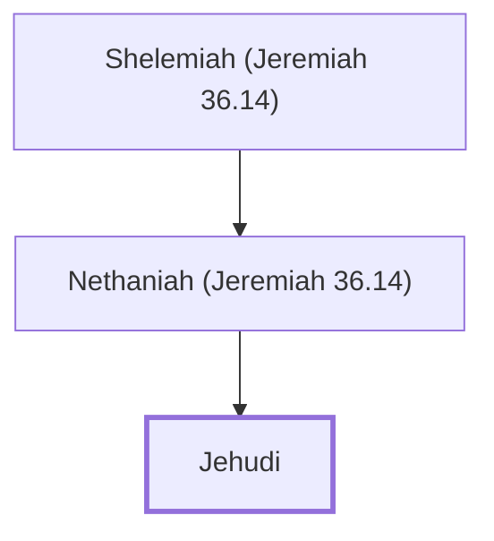

# Jehudi

An official who read Jeremiah's scroll to Jehoiakim.

**Original-language names:** יְהוּדִי (H3065)

## When

- **Placed around:** [[connections/timeline/7th century BC|606 BC]] *(Ussher: the median date of the passages naming them)*

## Family

- **Father:** [[connections/people/Nethaniah (Jeremiah 36.14)|Nethaniah (Jeremiah 36.14)]]

**Line of descent** (4 generations, father to son): [[connections/people/Cushi (Jeremiah 36.14)|Cushi (Jeremiah 36.14)]] → [[connections/people/Shelemiah (Jeremiah 36.14)|Shelemiah (Jeremiah 36.14)]] → [[connections/people/Nethaniah (Jeremiah 36.14)|Nethaniah (Jeremiah 36.14)]] → **Jehudi**

**Family group:** [[connections/genealogy/Family of Cushi (Jeremiah 36.14)|Family of Cushi (Jeremiah 36.14)]], generation 4

## Appears in

[[connections/chapters/24-jeremiah/Jeremiah 36|Jeremiah 36 (3)]]

## Appears in the same verse as

[[connections/people/Baruch (Jeremiah 32.12)|Baruch (Jeremiah 32.12)]] · [[connections/people/Cushi (Jeremiah 36.14)|Cushi (Jeremiah 36.14)]] · [[connections/people/Elishama (Jeremiah 36.12)|Elishama (Jeremiah 36.12)]] · [[connections/people/Neriah|Neriah]] · [[connections/people/Nethaniah (Jeremiah 36.14)|Nethaniah (Jeremiah 36.14)]] · [[connections/people/Shelemiah (Jeremiah 36.14)|Shelemiah (Jeremiah 36.14)]]
