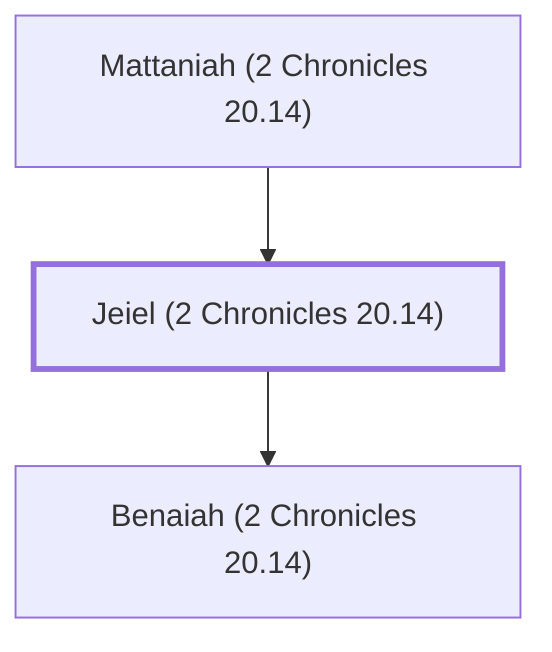

# Jeiel (2 Chronicles 20.14)

Grandfather of Jahaziel, a Levite during Jehoshaphat's reign.

**Original-language names:** יְעִיאֵל (H3273)

## Family

- **Father:** [[connections/people/Mattaniah (2 Chronicles 20.14)|Mattaniah (2 Chronicles 20.14)]]
- **Children:** [[connections/people/Benaiah (2 Chronicles 20.14)|Benaiah (2 Chronicles 20.14)]]

**Family group:** [[connections/genealogy/Family of Mattaniah (2 Chronicles 20.14)|Family of Mattaniah (2 Chronicles 20.14)]], generation 2

## Appears in

[[connections/chapters/14-2-chronicles/2 Chronicles 20|2 Chronicles 20]]

## Appears in the same verse as

[[connections/people/Asaph (1 Chronicles 6.24)|Asaph (1 Chronicles 6.24)]] · [[connections/people/Benaiah (2 Chronicles 20.14)|Benaiah (2 Chronicles 20.14)]] · [[connections/people/Jahaziel (2 Chronicles 20.14)|Jahaziel (2 Chronicles 20.14)]] · [[connections/people/Mattaniah (2 Chronicles 20.14)|Mattaniah (2 Chronicles 20.14)]] · [[connections/people/Zechariah (2 Chronicles 20.14)|Zechariah (2 Chronicles 20.14)]]
