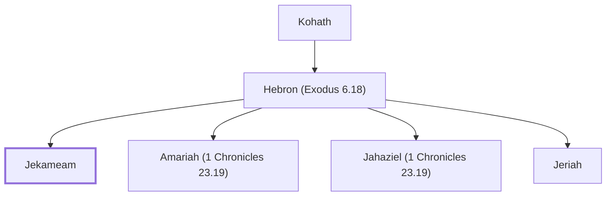

# Jekameam

A Levite, son of Hebron.

**Original-language names:** יְקַמְעָם (H3360)

## When

- **Placed around:** [[connections/timeline/11th century BC|1015 BC]] *(Ussher: the median date of the passages naming them)*

## Family

- **Father:** [[connections/people/Hebron (Exodus 6.18)|Hebron (Exodus 6.18)]]
- **Brothers and sisters:** [[connections/people/Amariah (1 Chronicles 23.19)|Amariah (1 Chronicles 23.19)]], [[connections/people/Jahaziel (1 Chronicles 23.19)|Jahaziel (1 Chronicles 23.19)]], [[connections/people/Jeriah|Jeriah]]
- **Tribe or nation:** Tribe of Levi

**Line of descent** (27 generations, father to son): [[connections/people/Adam|Adam]] → [[connections/people/Seth|Seth]] → [[connections/people/Enosh|Enosh]] → [[connections/people/Kenan|Kenan]] → [[connections/people/Mahalalel (Genesis 5.12)|Mahalalel (Genesis 5.12)]] → [[connections/people/Jared|Jared]] → [[connections/people/Enoch (Genesis 5.18)|Enoch (Genesis 5.18)]] → [[connections/people/Methuselah|Methuselah]] → [[connections/people/Lamech (Genesis 5.25)|Lamech (Genesis 5.25)]] → [[connections/people/Noah (Genesis 5.29)|Noah (Genesis 5.29)]] → [[connections/people/Shem|Shem]] → [[connections/people/Arpachshad|Arpachshad]] → [[connections/people/Cainan|Cainan]] → [[connections/people/Shelah (Genesis 10.24)|Shelah (Genesis 10.24)]] → [[connections/people/Eber (Genesis 10.21)|Eber (Genesis 10.21)]] → [[connections/people/Peleg|Peleg]] → [[connections/people/Reu|Reu]] → [[connections/people/Serug|Serug]] → [[connections/people/Nahor (Genesis 11.22)|Nahor (Genesis 11.22)]] → [[connections/people/Terah|Terah]] → [[connections/people/Abraham|Abraham]] → [[connections/people/Isaac|Isaac]] → [[connections/people/Israel|Israel]] → [[connections/people/Levi (Genesis 29.34)|Levi (Genesis 29.34)]] → [[connections/people/Kohath|Kohath]] → [[connections/people/Hebron (Exodus 6.18)|Hebron (Exodus 6.18)]] → **Jekameam**

**Family group:** [[connections/genealogy/Family of Adam|Family of Adam]], generation 27

## Appears in

[[connections/chapters/13-1-chronicles/1 Chronicles 23|1 Chronicles 23]] · [[connections/chapters/13-1-chronicles/1 Chronicles 24|1 Chronicles 24]]

## Appears in the same verse as

[[connections/people/Amariah (1 Chronicles 23.19)|Amariah (1 Chronicles 23.19) (2)]] · [[connections/people/Jahaziel (1 Chronicles 23.19)|Jahaziel (1 Chronicles 23.19) (2)]] · [[connections/people/Jeriah|Jeriah (2)]] · [[connections/people/Hebron (Exodus 6.18)|Hebron (Exodus 6.18)]]
