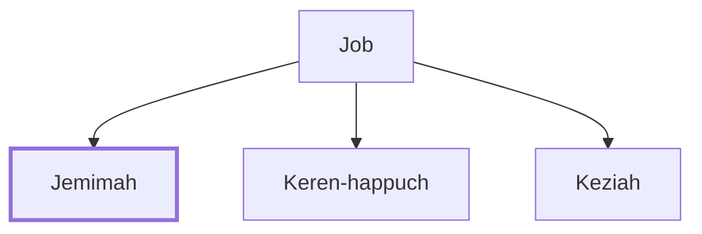

# Jemimah

One of Job's daughters born after his restoration.

**Original-language names:** יְמִימָה (H3224)

## When

- **Placed around:** [[connections/timeline/16th century BC|1520 BC]] *(Ussher: the median date of the passages naming them)*

## Family

- **Father:** [[connections/people/Job|Job]]
- **Brothers and sisters:** [[connections/people/Keren-happuch|Keren-happuch]], [[connections/people/Keziah|Keziah]]

**Family group:** [[connections/genealogy/Family of Job|Family of Job]], generation 2

## Appears in

[[connections/chapters/18-job/Job 42|Job 42]]

## Appears in the same verse as

[[connections/people/Keren-happuch|Keren-happuch]] · [[connections/people/Keziah|Keziah]]
