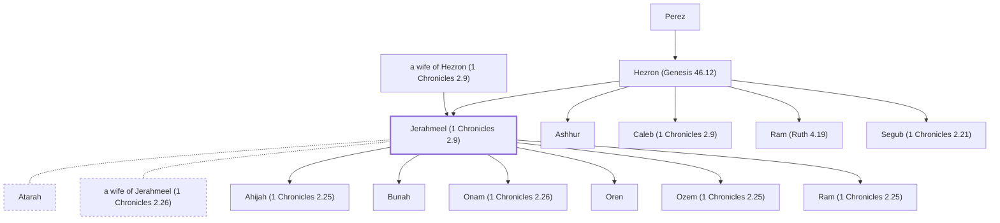

# Jerahmeel (1 Chronicles 2.9)

Son of Hezron, a descendant of Judah.

**Original-language names:** יְרַחְמְאֵל (H3396)

## When

- **Placed around:** [[connections/timeline/15th century BC|1470 BC]] *(Ussher: the median date of the passages naming them)*

## Family

- **Father:** [[connections/people/Hezron (Genesis 46.12)|Hezron (Genesis 46.12)]]
- **Mother:** [[connections/people/a wife of Hezron (1 Chronicles 2.9)|a wife of Hezron (1 Chronicles 2.9) (uncertain)]]
- **Brothers and sisters:** [[connections/people/Ashhur|Ashhur]], [[connections/people/Caleb (1 Chronicles 2.9)|Caleb (1 Chronicles 2.9)]], [[connections/people/Ram (Ruth 4.19)|Ram (Ruth 4.19)]], [[connections/people/Segub (1 Chronicles 2.21)|Segub (1 Chronicles 2.21)]]
- **Spouses:** [[connections/people/Atarah|Atarah]], [[connections/people/a wife of Jerahmeel (1 Chronicles 2.26)|a wife of Jerahmeel (1 Chronicles 2.26)]]
- **Children:** [[connections/people/Ahijah (1 Chronicles 2.25)|Ahijah (1 Chronicles 2.25)]], [[connections/people/Bunah|Bunah]], [[connections/people/Onam (1 Chronicles 2.26)|Onam (1 Chronicles 2.26)]], [[connections/people/Oren|Oren]], [[connections/people/Ozem (1 Chronicles 2.25)|Ozem (1 Chronicles 2.25)]], [[connections/people/Ram (1 Chronicles 2.25)|Ram (1 Chronicles 2.25)]]
- **Tribe or nation:** Tribe of Judah

**Line of descent** (27 generations, father to son): [[connections/people/Adam|Adam]] → [[connections/people/Seth|Seth]] → [[connections/people/Enosh|Enosh]] → [[connections/people/Kenan|Kenan]] → [[connections/people/Mahalalel (Genesis 5.12)|Mahalalel (Genesis 5.12)]] → [[connections/people/Jared|Jared]] → [[connections/people/Enoch (Genesis 5.18)|Enoch (Genesis 5.18)]] → [[connections/people/Methuselah|Methuselah]] → [[connections/people/Lamech (Genesis 5.25)|Lamech (Genesis 5.25)]] → [[connections/people/Noah (Genesis 5.29)|Noah (Genesis 5.29)]] → [[connections/people/Shem|Shem]] → [[connections/people/Arpachshad|Arpachshad]] → [[connections/people/Cainan|Cainan]] → [[connections/people/Shelah (Genesis 10.24)|Shelah (Genesis 10.24)]] → [[connections/people/Eber (Genesis 10.21)|Eber (Genesis 10.21)]] → [[connections/people/Peleg|Peleg]] → [[connections/people/Reu|Reu]] → [[connections/people/Serug|Serug]] → [[connections/people/Nahor (Genesis 11.22)|Nahor (Genesis 11.22)]] → [[connections/people/Terah|Terah]] → [[connections/people/Abraham|Abraham]] → [[connections/people/Isaac|Isaac]] → [[connections/people/Israel|Israel]] → [[connections/people/Judah (Genesis 29.35)|Judah (Genesis 29.35)]] → [[connections/people/Perez|Perez]] → [[connections/people/Hezron (Genesis 46.12)|Hezron (Genesis 46.12)]] → **Jerahmeel (1 Chronicles 2.9)**

**Family group:** [[connections/genealogy/Family of Adam|Family of Adam]], generation 27

## Appears in

[[connections/chapters/13-1-chronicles/1 Chronicles 2|1 Chronicles 2 (6)]]

## Appears in the same verse as

[[connections/people/Caleb (1 Chronicles 2.9)|Caleb (1 Chronicles 2.9) (2)]] · [[connections/people/Hezron (Genesis 46.12)|Hezron (Genesis 46.12) (2)]] · [[connections/people/Ram (1 Chronicles 2.25)|Ram (1 Chronicles 2.25) (2)]] · [[connections/people/Ahijah (1 Chronicles 2.25)|Ahijah (1 Chronicles 2.25)]] · [[connections/people/Atarah|Atarah]] · [[connections/people/Bunah|Bunah]] · [[connections/people/Eker|Eker]] · [[connections/people/Hebron (1 Chronicles 2.42)|Hebron (1 Chronicles 2.42)]] · [[connections/people/Jamin (1 Chronicles 2.27)|Jamin (1 Chronicles 2.27)]] · [[connections/people/Jonathan (1 Chronicles 2.32)|Jonathan (1 Chronicles 2.32)]] · [[connections/people/Maaz|Maaz]] · [[connections/people/Mareshah (1 Chronicles 2.42)|Mareshah (1 Chronicles 2.42)]] · [[connections/people/Mesha (1 Chronicles 2.42)|Mesha (1 Chronicles 2.42)]] · [[connections/people/Onam (1 Chronicles 2.26)|Onam (1 Chronicles 2.26)]] · [[connections/people/Oren|Oren]] · [[connections/people/Ozem (1 Chronicles 2.25)|Ozem (1 Chronicles 2.25)]] · [[connections/people/Peleth (1 Chronicles 2.33)|Peleth (1 Chronicles 2.33)]] · [[connections/people/Ram (Ruth 4.19)|Ram (Ruth 4.19)]] · [[connections/people/Zaza|Zaza]] · [[connections/places/Ziph (Joshua 15.55)|Ziph (Joshua 15.55)]]
