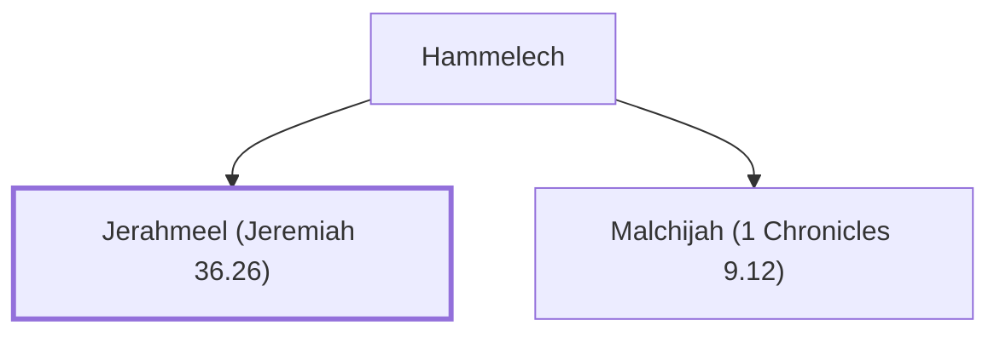

# Jerahmeel (Jeremiah 36.26)

Son of Hammelech, sent to arrest Jeremiah.

**Original-language names:** יְרַחְמְאֵל (H3396)

## When

- **Placed around:** [[connections/timeline/7th century BC|606 BC]] *(Ussher: the median date of the passages naming them)*

## Family

- **Father:** [[connections/people/Hammelech|Hammelech]]
- **Brothers and sisters:** [[connections/people/Malchijah (1 Chronicles 9.12)|Malchijah (1 Chronicles 9.12)]]

**Family group:** [[connections/genealogy/Family of Hammelech|Family of Hammelech]], generation 2

## Appears in

[[connections/chapters/24-jeremiah/Jeremiah 36|Jeremiah 36]]

## Appears in the same verse as

[[connections/people/Abdeel|Abdeel]] · [[connections/people/Azriel (Jeremiah 36.26)|Azriel (Jeremiah 36.26)]] · [[connections/people/Baruch (Jeremiah 32.12)|Baruch (Jeremiah 32.12)]] · [[connections/people/Hammelech|Hammelech]] · [[connections/people/Jeremiah (2 Chronicles 35.25)|Jeremiah (2 Chronicles 35.25)]] · [[connections/people/Seraiah (Jeremiah 36.26)|Seraiah (Jeremiah 36.26)]] · [[connections/people/Shelemiah (Jeremiah 36.26)|Shelemiah (Jeremiah 36.26)]]
