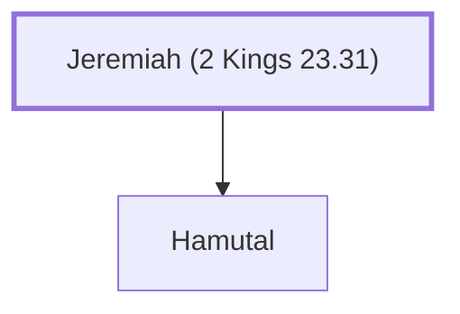

# Jeremiah (2 Kings 23.31)

Father-in-law of Jehoahaz and Zedekiah

**Original-language names:** יִרְמְיָ֫הוּ (H3414)

## When

- **Placed around:** [[connections/timeline/6th century BC|599 BC]] *(Ussher: the median date of the passages naming them)*

## Family

- **Children:** [[connections/people/Hamutal|Hamutal]]

**Family group:** [[connections/genealogy/Family of Adam|Family of Adam]], generation 1

## Appears in

[[connections/chapters/12-2-kings/2 Kings 23|2 Kings 23]] · [[connections/chapters/12-2-kings/2 Kings 24|2 Kings 24]] · [[connections/chapters/24-jeremiah/Jeremiah 52|Jeremiah 52]]

## Appears in the same verse as

[[connections/people/Hamutal|Hamutal (3)]] · [[connections/places/Jerusalem|Jerusalem (3)]] · [[connections/places/Libnah (Joshua 10.29)|Libnah (Joshua 10.29) (3)]] · [[connections/people/Zedekiah (2 Kings 24.17)|Zedekiah (2 Kings 24.17) (2)]] · [[connections/people/Jehoahaz (2 Kings 23.30)|Jehoahaz (2 Kings 23.30)]]
