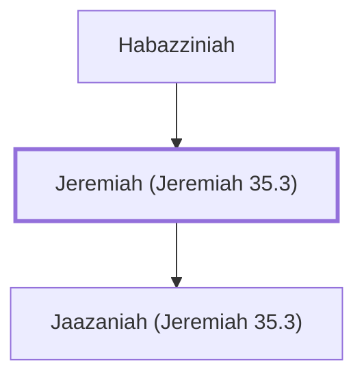

# Jeremiah (Jeremiah 35.3)

Son of Habazziniah, a Rechabite.

**Original-language names:** יִרְמְיָ֫הוּ (H3414)

## When

- **Placed around:** [[connections/timeline/7th century BC|607 BC]] *(Ussher: the median date of the passages naming them)*

## Family

- **Father:** [[connections/people/Habazziniah|Habazziniah]]
- **Children:** [[connections/people/Jaazaniah (Jeremiah 35.3)|Jaazaniah (Jeremiah 35.3)]]

**Family group:** [[connections/genealogy/Family of Habazziniah|Family of Habazziniah]], generation 2

## Appears in

[[connections/chapters/24-jeremiah/Jeremiah 35|Jeremiah 35]]

## Appears in the same verse as

[[connections/people/Habazziniah|Habazziniah]] · [[connections/people/Jaazaniah (Jeremiah 35.3)|Jaazaniah (Jeremiah 35.3)]]
