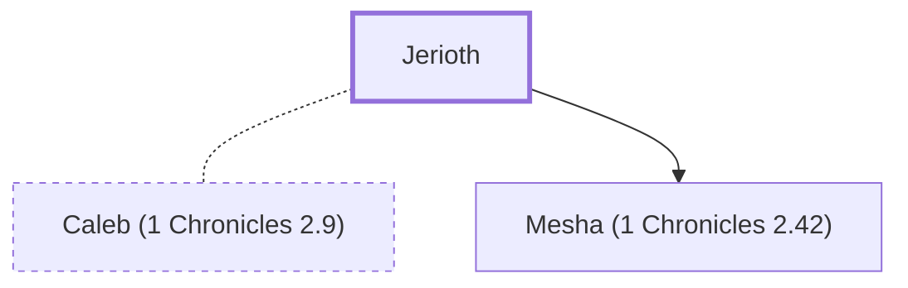

# Jerioth

Wife of Caleb; mother of unnamed children.

**Original-language names:** יְרִיעוֹת (H3408)

## When

- **Placed around:** [[connections/timeline/15th century BC|1470 BC]] *(Ussher: the median date of the passages naming them)*

## Family

- **Spouses:** [[connections/people/Caleb (1 Chronicles 2.9)|Caleb (1 Chronicles 2.9)]]
- **Children:** [[connections/people/Mesha (1 Chronicles 2.42)|Mesha (1 Chronicles 2.42) (uncertain)]]
- **Tribe or nation:** Tribe of Judah(?)

**Family group:** [[connections/genealogy/Family of Adam|Family of Adam]], generation 29

## Appears in

[[connections/chapters/13-1-chronicles/1 Chronicles 2|1 Chronicles 2]]

## Appears in the same verse as

[[connections/people/Ardon|Ardon]] · [[connections/people/Azubah (1 Chronicles 2.18)|Azubah (1 Chronicles 2.18)]] · [[connections/people/Caleb (1 Chronicles 2.9)|Caleb (1 Chronicles 2.9)]] · [[connections/people/Hezron (Genesis 46.12)|Hezron (Genesis 46.12)]] · [[connections/people/Jesher|Jesher]] · [[connections/people/Shobab (1 Chronicles 2.18)|Shobab (1 Chronicles 2.18)]]
