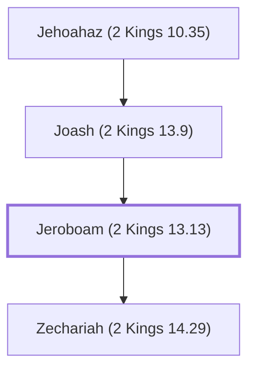

# Jeroboam (2 Kings 13.13)

King of Israel, son of Jehoash.

**Original-language names:** יָֽרָבְעָם (H3379)

## When

- **Placed around:** [[connections/timeline/8th century BC|787 BC]] *(Ussher: the median date of the passages naming them)*

## Family

- **Father:** [[connections/people/Joash (2 Kings 13.9)|Joash (2 Kings 13.9)]]
- **Children:** [[connections/people/Zechariah (2 Kings 14.29)|Zechariah (2 Kings 14.29)]]
- **Tribe or nation:** Israel

**Line of descent** (6 generations, father to son): [[connections/people/Nimshi|Nimshi]] → [[connections/people/Jehoshaphat (2 Kings 9.2)|Jehoshaphat (2 Kings 9.2)]] → [[connections/people/Jehu (1 Kings 19.16)|Jehu (1 Kings 19.16)]] → [[connections/people/Jehoahaz (2 Kings 10.35)|Jehoahaz (2 Kings 10.35)]] → [[connections/people/Joash (2 Kings 13.9)|Joash (2 Kings 13.9)]] → **Jeroboam (2 Kings 13.13)**

**Family group:** [[connections/genealogy/Family of Nimshi|Family of Nimshi]], generation 6

## Events

- [[connections/timeline/9th century BC|825 BC]] · [[connections/events/Reign of Jeroboam II|Reign of Jeroboam II]]
- [[connections/timeline/8th century BC|784 BC]] · [[connections/events/Death of Jeroboam II|Death of Jeroboam II]]

## Appears in

[[connections/chapters/12-2-kings/2 Kings 13|2 Kings 13]] · [[connections/chapters/12-2-kings/2 Kings 14|2 Kings 14 (5)]] · [[connections/chapters/12-2-kings/2 Kings 15|2 Kings 15 (2)]] · [[connections/chapters/13-1-chronicles/1 Chronicles 5|1 Chronicles 5]] · [[connections/chapters/28-hosea/Hosea 1|Hosea 1]] · [[connections/chapters/30-amos/Amos 1|Amos 1]] · [[connections/chapters/30-amos/Amos 7|Amos 7 (3)]]

## Appears in the same verse as

[[connections/people/Israel|Israel (14)]] · [[connections/people/Judah (Genesis 29.35)|Judah (Genesis 29.35) (7)]] · [[connections/people/Joash (2 Kings 13.9)|Joash (2 Kings 13.9) (6)]] · [[connections/people/Uzziah (2 Kings 14.21)|Uzziah (2 Kings 14.21) (4)]] · [[connections/places/Samaria|Samaria (4)]] · [[connections/people/Amos (Amos 1.1)|Amos (Amos 1.1) (3)]] · [[connections/people/Amaziah (2 Kings 12.22)|Amaziah (2 Kings 12.22) (2)]] · [[connections/people/Jotham (2 Kings 15.5)|Jotham (2 Kings 15.5) (2)]] · [[connections/people/Zechariah (2 Kings 14.29)|Zechariah (2 Kings 14.29) (2)]] · [[connections/people/Ahaz (2 Kings 15.38)|Ahaz (2 Kings 15.38)]] · [[connections/people/Amaziah (Amos 7.10)|Amaziah (Amos 7.10)]] · [[connections/people/Beeri (Hosea 1.1)|Beeri (Hosea 1.1)]] · [[connections/people/Hezekiah (2 Kings 16.20)|Hezekiah (2 Kings 16.20)]] · [[connections/people/Hosea|Hosea]] · [[connections/people/Isaac|Isaac]] · [[connections/people/Joash (2 Kings 11.2)|Joash (2 Kings 11.2)]] · [[connections/places/Bethel (Genesis 12.8)|Bethel (Genesis 12.8)]] · [[connections/places/Damascus|Damascus]] · [[connections/places/Hamath|Hamath]] · [[connections/places/Tekoa|Tekoa]]
