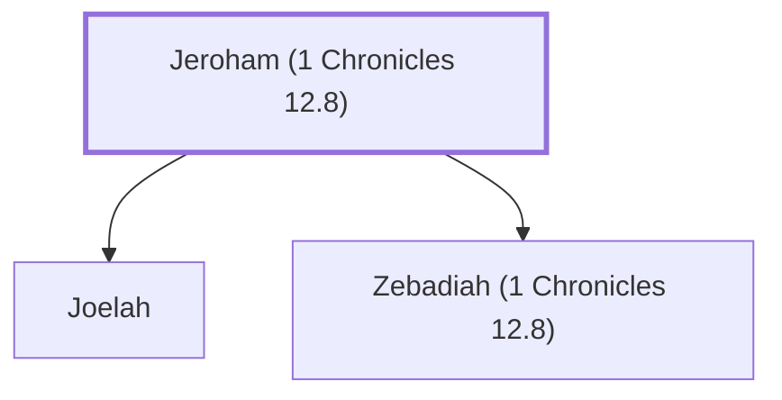

# Jeroham (1 Chronicles 12.8)

A Benjamite warrior who joined David at Ziklag.

**Original-language names:** יְרֹחָם (H3395)

## Family

- **Children:** [[connections/people/Joelah|Joelah]], [[connections/people/Zebadiah (1 Chronicles 12.8)|Zebadiah (1 Chronicles 12.8)]]

**Family group:** [[connections/genealogy/Family of Jeroham (1 Chronicles 12.8)|Family of Jeroham (1 Chronicles 12.8)]], generation 1

## Appears in

[[connections/chapters/13-1-chronicles/1 Chronicles 12|1 Chronicles 12]]

## Appears in the same verse as

[[connections/people/Joelah|Joelah]] · [[connections/people/Zebadiah (1 Chronicles 12.8)|Zebadiah (1 Chronicles 12.8)]] · [[connections/places/Gedor (Joshua 12.13)|Gedor (Joshua 12.13)]]
