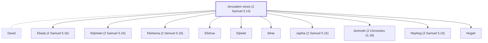

# Jerusalem wives (2 Samuel 5.13)

Wives David took in Jerusalem

*Not named in the text. Included because a family line passes through this person.*

**Original-language names:** . (H0802J)

## Family

- **Spouses:** [[connections/people/David|David]]
- **Children:** [[connections/people/Eliada (2 Samuel 5.16)|Eliada (2 Samuel 5.16)]], [[connections/people/Eliphelet (2 Samuel 5.16)|Eliphelet (2 Samuel 5.16)]], [[connections/people/Elishama (2 Samuel 5.16)|Elishama (2 Samuel 5.16)]], [[connections/people/Elishua|Elishua]], [[connections/people/Elpelet|Elpelet]], [[connections/people/Ibhar|Ibhar]], [[connections/people/Japhia (2 Samuel 5.15)|Japhia (2 Samuel 5.15)]], [[connections/people/Jerimoth (2 Chronicles 11.18)|Jerimoth (2 Chronicles 11.18) (uncertain)]], [[connections/people/Nepheg (2 Samuel 5.15)|Nepheg (2 Samuel 5.15)]], [[connections/people/Nogah|Nogah]]
- **Tribe or nation:** Tribe of Judah

**Family group:** [[connections/genealogy/Family of Adam|Family of Adam]], generation 36

## Mentioned in

[[connections/chapters/10-2-samuel/2 Samuel 5|2 Samuel 5]]
