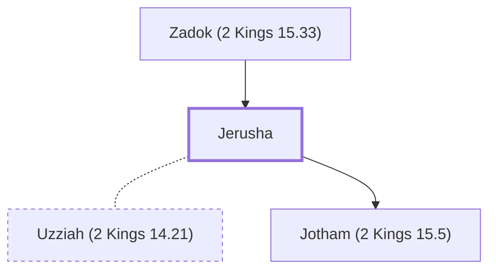

# Jerusha

Mother of King Jotham of Judah.

**Original-language names:** יְרוּשָׁא (H3388) · יְרוּשָׁה (H3388)

## When

- **Placed around:** [[connections/timeline/8th century BC|753 BC]] *(Ussher: the median date of the passages naming them)*

## Family

- **Father:** [[connections/people/Zadok (2 Kings 15.33)|Zadok (2 Kings 15.33)]]
- **Spouses:** [[connections/people/Uzziah (2 Kings 14.21)|Uzziah (2 Kings 14.21)]]
- **Children:** [[connections/people/Jotham (2 Kings 15.5)|Jotham (2 Kings 15.5)]]

**Family group:** [[connections/genealogy/Family of Adam|Family of Adam]], generation 2

## Appears in

[[connections/chapters/12-2-kings/2 Kings 15|2 Kings 15]] · [[connections/chapters/14-2-chronicles/2 Chronicles 27|2 Chronicles 27]]

## Appears in the same verse as

[[connections/people/Zadok (2 Kings 15.33)|Zadok (2 Kings 15.33) (2)]] · [[connections/places/Jerusalem|Jerusalem (2)]] · [[connections/people/Jotham (2 Kings 15.5)|Jotham (2 Kings 15.5)]]
