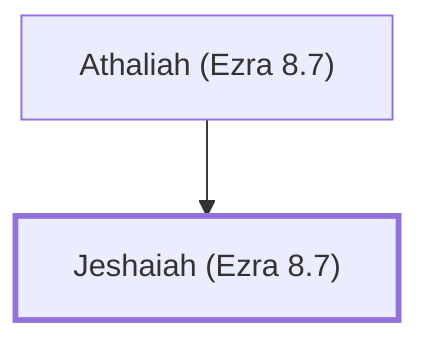

# Jeshaiah (Ezra 8.7)

A descendant of Elam who returned with Ezra.

**Original-language names:** יְשַׁעְיָה (H3470b)

## When

- **Placed around:** [[connections/timeline/5th century BC|457 BC]] *(Ussher: the median date of the passages naming them)*

## Family

- **Father:** [[connections/people/Athaliah (Ezra 8.7)|Athaliah (Ezra 8.7)]]

**Family group:** [[connections/genealogy/Family of Athaliah (Ezra 8.7)|Family of Athaliah (Ezra 8.7)]], generation 2

## Appears in

[[connections/chapters/15-ezra/Ezra 8|Ezra 8]]

## Appears in the same verse as

[[connections/people/Athaliah (Ezra 8.7)|Athaliah (Ezra 8.7)]] · [[connections/people/Elam (Ezra 2.7)|Elam (Ezra 2.7)]]
