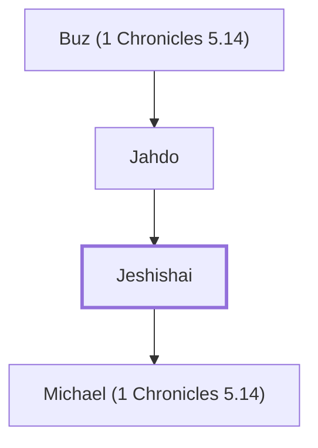

# Jeshishai

An ancestor of Gadite leaders.

**Original-language names:** יְשִׁישַׁי (H3454)

## When

- **Placed around:** [[connections/timeline/11th century BC|1060 BC]] *(Ussher: the median date of the passages naming them)*

## Family

- **Father:** [[connections/people/Jahdo|Jahdo]]
- **Children:** [[connections/people/Michael (1 Chronicles 5.14)|Michael (1 Chronicles 5.14)]]
- **Tribe or nation:** Tribe of Gad

**Line of descent** (3 generations, father to son): [[connections/people/Buz (1 Chronicles 5.14)|Buz (1 Chronicles 5.14)]] → [[connections/people/Jahdo|Jahdo]] → **Jeshishai**

**Family group:** [[connections/genealogy/Family of Buz (1 Chronicles 5.14)|Family of Buz (1 Chronicles 5.14)]], generation 3

## Appears in

[[connections/chapters/13-1-chronicles/1 Chronicles 5|1 Chronicles 5]]

## Appears in the same verse as

[[connections/people/Abihail (1 Chronicles 5.14)|Abihail (1 Chronicles 5.14)]] · [[connections/people/Buz (1 Chronicles 5.14)|Buz (1 Chronicles 5.14)]] · [[connections/people/Gilead (1 Chronicles 5.14)|Gilead (1 Chronicles 5.14)]] · [[connections/people/Huri|Huri]] · [[connections/people/Jahdo|Jahdo]] · [[connections/people/Jaroah|Jaroah]] · [[connections/people/Michael (1 Chronicles 5.14)|Michael (1 Chronicles 5.14)]]
