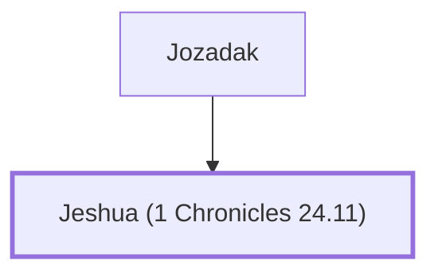

# Jeshua (1 Chronicles 24.11)

Head of a priestly family that returned from exile.

**Original-language names:** יֵשׁוּעַ (H3442)

## When

- **Placed around:** [[connections/timeline/5th century BC|456 BC]] *(Ussher: the median date of the passages naming them)*

## Family

- **Father:** [[connections/people/Jozadak|Jozadak]]

**Family group:** [[connections/genealogy/Family of Jozadak|Family of Jozadak]], generation 2

## Appears in

[[connections/chapters/13-1-chronicles/1 Chronicles 24|1 Chronicles 24]] · [[connections/chapters/15-ezra/Ezra 2|Ezra 2]] · [[connections/chapters/15-ezra/Ezra 10|Ezra 10]] · [[connections/chapters/16-nehemiah/Nehemiah 7|Nehemiah 7]]

## Appears in the same verse as

[[connections/people/Jedaiah (1 Chronicles 24.7)|Jedaiah (1 Chronicles 24.7) (2)]] · [[connections/people/Eliezer (Ezra 10.18)|Eliezer (Ezra 10.18)]] · [[connections/people/Gedaliah (Ezra 10.18)|Gedaliah (Ezra 10.18)]] · [[connections/people/Jarib (Ezra 10.18)|Jarib (Ezra 10.18)]] · [[connections/people/Jozadak|Jozadak]] · [[connections/people/Maaseiah (Ezra 10.18)|Maaseiah (Ezra 10.18)]] · [[connections/people/Shecaniah (1 Chronicles 24.11)|Shecaniah (1 Chronicles 24.11)]]
