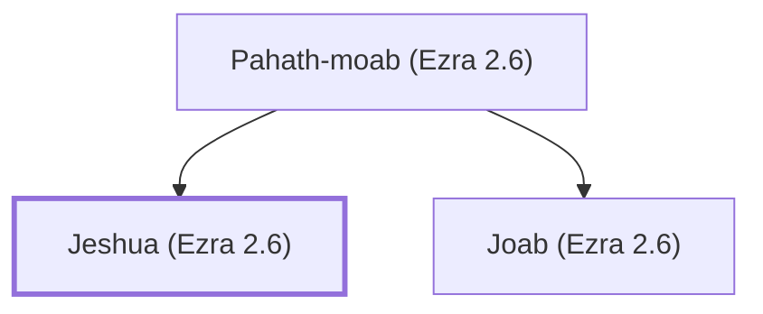

# Jeshua (Ezra 2.6)

Leader of a group that returned from Babylonian exile.

**Original-language names:** יֵשׁוּעַ (H3442)

## When

- **Placed around:** [[connections/timeline/5th century BC|445 BC]] *(Ussher: the median date of the passages naming them)*

## Family

- **Father:** [[connections/people/Pahath-moab (Ezra 2.6)|Pahath-moab (Ezra 2.6)]]
- **Brothers and sisters:** [[connections/people/Joab (Ezra 2.6)|Joab (Ezra 2.6)]]

**Family group:** [[connections/genealogy/Family of Pahath-moab (Ezra 2.6)|Family of Pahath-moab (Ezra 2.6)]], generation 2

## Appears in

[[connections/chapters/15-ezra/Ezra 2|Ezra 2]] · [[connections/chapters/16-nehemiah/Nehemiah 7|Nehemiah 7]]

## Appears in the same verse as

[[connections/people/Joab (Ezra 2.6)|Joab (Ezra 2.6) (2)]] · [[connections/people/Pahath-moab (Ezra 2.6)|Pahath-moab (Ezra 2.6) (2)]]
