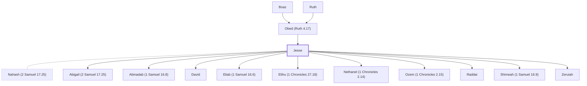

# Jesse

Father of King David.

**Original-language names:** יִשַׁי (H3448) · Ἰεσσαί (G2421)

## When

- **Placed around:** [[connections/timeline/11th century BC|1062 BC]] *(Ussher: the median date of the passages naming them)*

## Family

- **Father:** [[connections/people/Obed (Ruth 4.17)|Obed (Ruth 4.17)]]
- **Spouses:** [[connections/people/Nahash (2 Samuel 17.25)|Nahash (2 Samuel 17.25)]]
- **Children:** [[connections/people/Abigail (2 Samuel 17.25)|Abigail (2 Samuel 17.25) (uncertain)]], [[connections/people/Abinadab (1 Samuel 16.8)|Abinadab (1 Samuel 16.8)]], [[connections/people/David|David]], [[connections/people/Eliab (1 Samuel 16.6)|Eliab (1 Samuel 16.6)]], [[connections/people/Elihu (1 Chronicles 27.18)|Elihu (1 Chronicles 27.18)]], [[connections/people/Nethanel (1 Chronicles 2.14)|Nethanel (1 Chronicles 2.14)]], [[connections/people/Ozem (1 Chronicles 2.15)|Ozem (1 Chronicles 2.15)]], [[connections/people/Raddai|Raddai]], [[connections/people/Shimeah (1 Samuel 16.9)|Shimeah (1 Samuel 16.9)]], [[connections/people/Zeruiah|Zeruiah]]
- **Tribe or nation:** Tribe of Judah

**Line of descent** (33 generations, father to son): [[connections/people/Adam|Adam]] → [[connections/people/Seth|Seth]] → [[connections/people/Enosh|Enosh]] → [[connections/people/Kenan|Kenan]] → [[connections/people/Mahalalel (Genesis 5.12)|Mahalalel (Genesis 5.12)]] → [[connections/people/Jared|Jared]] → [[connections/people/Enoch (Genesis 5.18)|Enoch (Genesis 5.18)]] → [[connections/people/Methuselah|Methuselah]] → [[connections/people/Lamech (Genesis 5.25)|Lamech (Genesis 5.25)]] → [[connections/people/Noah (Genesis 5.29)|Noah (Genesis 5.29)]] → [[connections/people/Shem|Shem]] → [[connections/people/Arpachshad|Arpachshad]] → [[connections/people/Cainan|Cainan]] → [[connections/people/Shelah (Genesis 10.24)|Shelah (Genesis 10.24)]] → [[connections/people/Eber (Genesis 10.21)|Eber (Genesis 10.21)]] → [[connections/people/Peleg|Peleg]] → [[connections/people/Reu|Reu]] → [[connections/people/Serug|Serug]] → [[connections/people/Nahor (Genesis 11.22)|Nahor (Genesis 11.22)]] → [[connections/people/Terah|Terah]] → [[connections/people/Abraham|Abraham]] → [[connections/people/Isaac|Isaac]] → [[connections/people/Israel|Israel]] → [[connections/people/Judah (Genesis 29.35)|Judah (Genesis 29.35)]] → [[connections/people/Perez|Perez]] → [[connections/people/Hezron (Genesis 46.12)|Hezron (Genesis 46.12)]] → [[connections/people/Ram (Ruth 4.19)|Ram (Ruth 4.19)]] → [[connections/people/Amminadab (Exodus 6.23)|Amminadab (Exodus 6.23)]] → [[connections/people/Nahshon|Nahshon]] → [[connections/people/Salmon|Salmon]] → [[connections/people/Boaz|Boaz]] → [[connections/people/Obed (Ruth 4.17)|Obed (Ruth 4.17)]] → **Jesse**

**Family group:** [[connections/genealogy/Family of Adam|Family of Adam]], generation 33

## Appears in

[[connections/chapters/08-ruth/Ruth 4|Ruth 4 (2)]] · [[connections/chapters/09-1-samuel/1 Samuel 16|1 Samuel 16 (11)]] · [[connections/chapters/09-1-samuel/1 Samuel 17|1 Samuel 17 (5)]] · [[connections/chapters/09-1-samuel/1 Samuel 20|1 Samuel 20 (3)]] · [[connections/chapters/09-1-samuel/1 Samuel 22|1 Samuel 22 (4)]] · [[connections/chapters/09-1-samuel/1 Samuel 25|1 Samuel 25]] · [[connections/chapters/10-2-samuel/2 Samuel 20|2 Samuel 20]] · [[connections/chapters/10-2-samuel/2 Samuel 23|2 Samuel 23]] · [[connections/chapters/11-1-kings/1 Kings 12|1 Kings 12]] · [[connections/chapters/13-1-chronicles/1 Chronicles 2|1 Chronicles 2 (2)]] · [[connections/chapters/13-1-chronicles/1 Chronicles 10|1 Chronicles 10]] · [[connections/chapters/13-1-chronicles/1 Chronicles 12|1 Chronicles 12]] · [[connections/chapters/13-1-chronicles/1 Chronicles 29|1 Chronicles 29]] · [[connections/chapters/14-2-chronicles/2 Chronicles 10|2 Chronicles 10]] · [[connections/chapters/14-2-chronicles/2 Chronicles 11|2 Chronicles 11]] · [[connections/chapters/19-psalms/Psalms 72|Psalms 72]] · [[connections/chapters/23-isaiah/Isaiah 11|Isaiah 11 (2)]] · [[connections/chapters/40-matthew/Matthew 1|Matthew 1 (2)]] · [[connections/chapters/42-luke/Luke 3|Luke 3]] · [[connections/chapters/44-acts/Acts 13|Acts 13]] · [[connections/chapters/45-romans/Romans 15|Romans 15]]

## Appears in the same verse as

[[connections/people/David|David (22)]] · [[connections/people/Saul|Saul (12)]] · [[connections/people/Israel|Israel (6)]] · [[connections/people/Obed (Ruth 4.17)|Obed (Ruth 4.17) (5)]] · [[connections/people/Samuel|Samuel (4)]] · [[connections/people/Abinadab (1 Samuel 16.8)|Abinadab (1 Samuel 16.8) (3)]] · [[connections/people/Boaz|Boaz (3)]] · [[connections/people/Eliab (1 Samuel 16.6)|Eliab (1 Samuel 16.6) (3)]] · [[connections/people/Shimeah (1 Samuel 16.9)|Shimeah (1 Samuel 16.9) (3)]] · [[connections/people/Benjamin (Genesis 35.18)|Benjamin (Genesis 35.18) (2)]] · [[connections/people/Jonathan (1 Samuel 13.2)|Jonathan (1 Samuel 13.2) (2)]] · [[connections/people/Salmon|Salmon (2)]] · [[connections/people/Abihail (2 Chronicles 11.18)|Abihail (2 Chronicles 11.18)]] · [[connections/people/Ahimelech (1 Samuel 14.3)|Ahimelech (1 Samuel 14.3)]] · [[connections/people/Ahitub (1 Samuel 14.3)|Ahitub (1 Samuel 14.3)]] · [[connections/people/Amasai (1 Chronicles 12.19)|Amasai (1 Chronicles 12.19)]] · [[connections/people/Bichri|Bichri]] · [[connections/people/Doeg|Doeg]] · [[connections/people/Isaiah|Isaiah]] · [[connections/people/Jerimoth (2 Chronicles 11.18)|Jerimoth (2 Chronicles 11.18)]] · [[connections/people/Judah (Genesis 29.35)|Judah (Genesis 29.35)]] · [[connections/people/Mahalath (2 Chronicles 11.18)|Mahalath (2 Chronicles 11.18)]] · [[connections/people/Nabal|Nabal]] · [[connections/people/Nahshon|Nahshon]] · [[connections/people/Naomi|Naomi]] · [[connections/people/Rahab|Rahab]] · [[connections/people/Rehoboam|Rehoboam]] · [[connections/people/Ruth|Ruth]] · [[connections/people/Sheba (2 Samuel 20.1)|Sheba (2 Samuel 20.1)]] · [[connections/people/Solomon|Solomon]] · [[connections/people/Uriah (2 Samuel 11.3)|Uriah (2 Samuel 11.3)]] · [[connections/places/Bethlehem (Genesis 35.16)|Bethlehem (Genesis 35.16)]] · [[connections/places/Nob|Nob]]
