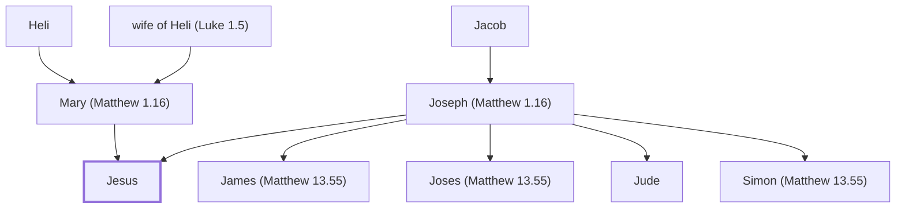

# Jesus

The Son of God and Savior of the world.

**Also called:** Lord, Christ, Immanuel

**Original-language names:** Ἰησοῦς (G2424) · Χριστός (G5547) · עִמָּנוּאֵל (H6005) · Ἐμμανουήλ (G1694)

## When

- **Lived:** [[connections/timeline/1st century BC|4 BC]] – [[connections/timeline/1st century AD|AD 30]] *(Jones)*
- **Placed around:** [[connections/timeline/1st century AD|AD 33]] *(Ussher: the median date of the passages naming them)*

## Family

- **Father:** [[connections/people/Joseph (Matthew 1.16)|Joseph (Matthew 1.16)]]
- **Mother:** [[connections/people/Mary (Matthew 1.16)|Mary (Matthew 1.16)]]
- **Brothers and sisters:** [[connections/people/James (Matthew 13.55)|James (Matthew 13.55)]], [[connections/people/Joses (Matthew 13.55)|Joses (Matthew 13.55)]], [[connections/people/Jude|Jude]], [[connections/people/Simon (Matthew 13.55)|Simon (Matthew 13.55)]]
- **Tribe or nation:** Tribe of Judah

**Line of descent** (75 generations, father to son): [[connections/people/Adam|Adam]] → [[connections/people/Seth|Seth]] → [[connections/people/Enosh|Enosh]] → [[connections/people/Kenan|Kenan]] → [[connections/people/Mahalalel (Genesis 5.12)|Mahalalel (Genesis 5.12)]] → [[connections/people/Jared|Jared]] → [[connections/people/Enoch (Genesis 5.18)|Enoch (Genesis 5.18)]] → [[connections/people/Methuselah|Methuselah]] → [[connections/people/Lamech (Genesis 5.25)|Lamech (Genesis 5.25)]] → [[connections/people/Noah (Genesis 5.29)|Noah (Genesis 5.29)]] → [[connections/people/Shem|Shem]] → [[connections/people/Arpachshad|Arpachshad]] → [[connections/people/Cainan|Cainan]] → [[connections/people/Shelah (Genesis 10.24)|Shelah (Genesis 10.24)]] → [[connections/people/Eber (Genesis 10.21)|Eber (Genesis 10.21)]] → [[connections/people/Peleg|Peleg]] → [[connections/people/Reu|Reu]] → [[connections/people/Serug|Serug]] → [[connections/people/Nahor (Genesis 11.22)|Nahor (Genesis 11.22)]] → [[connections/people/Terah|Terah]] → [[connections/people/Abraham|Abraham]] → [[connections/people/Isaac|Isaac]] → [[connections/people/Israel|Israel]] → [[connections/people/Judah (Genesis 29.35)|Judah (Genesis 29.35)]] → [[connections/people/Perez|Perez]] → [[connections/people/Hezron (Genesis 46.12)|Hezron (Genesis 46.12)]] → [[connections/people/Ram (Ruth 4.19)|Ram (Ruth 4.19)]] → [[connections/people/Amminadab (Exodus 6.23)|Amminadab (Exodus 6.23)]] → [[connections/people/Nahshon|Nahshon]] → [[connections/people/Salmon|Salmon]] → [[connections/people/Boaz|Boaz]] → [[connections/people/Obed (Ruth 4.17)|Obed (Ruth 4.17)]] → [[connections/people/Jesse|Jesse]] → [[connections/people/David|David]] → [[connections/people/Solomon|Solomon]] → [[connections/people/Rehoboam|Rehoboam]] → [[connections/people/Abijah (1 Kings 14.31)|Abijah (1 Kings 14.31)]] → [[connections/people/Asa (1 Kings 15.8)|Asa (1 Kings 15.8)]] → [[connections/people/Jehoshaphat (1 Kings 15.24)|Jehoshaphat (1 Kings 15.24)]] → [[connections/people/Jehoram (1 Kings 22.51)|Jehoram (1 Kings 22.51)]] → [[connections/people/Ahaziah (2 Kings 8.24)|Ahaziah (2 Kings 8.24)]] → [[connections/people/Joash (2 Kings 11.2)|Joash (2 Kings 11.2)]] → [[connections/people/Amaziah (2 Kings 12.22)|Amaziah (2 Kings 12.22)]] → [[connections/people/Uzziah (2 Kings 14.21)|Uzziah (2 Kings 14.21)]] → [[connections/people/Jotham (2 Kings 15.5)|Jotham (2 Kings 15.5)]] → [[connections/people/Ahaz (2 Kings 15.38)|Ahaz (2 Kings 15.38)]] → [[connections/people/Hezekiah (2 Kings 16.20)|Hezekiah (2 Kings 16.20)]] → [[connections/people/Manasseh (2 Kings 20.21)|Manasseh (2 Kings 20.21)]] → [[connections/people/Amon (2 Kings 21.18)|Amon (2 Kings 21.18)]] → [[connections/people/Josiah (1 Kings 13.2)|Josiah (1 Kings 13.2)]] → [[connections/people/Jehoiakim|Jehoiakim]] → [[connections/people/Jehoiachin|Jehoiachin]] → [[connections/people/Shealtiel (1 Chronicles 3.17)|Shealtiel (1 Chronicles 3.17)]] → [[connections/people/Pedaiah (1 Chronicles 3.18)|Pedaiah (1 Chronicles 3.18)]] → [[connections/people/Zerubbabel (1 Chronicles 3.19)|Zerubbabel (1 Chronicles 3.19)]] → [[connections/people/Abiud|Abiud]] → [[connections/people/Eliakim (Matthew 1.13)|Eliakim (Matthew 1.13)]] → [[connections/people/Azor|Azor]] → [[connections/people/Zadok (Matthew 1.14)|Zadok (Matthew 1.14)]] → [[connections/people/Achim|Achim]] → [[connections/people/Eliud|Eliud]] → [[connections/people/Eleazar (Matthew 1.15)|Eleazar (Matthew 1.15)]] → [[connections/people/Matthan|Matthan]] → [[connections/people/Unnamed 1 (Matthew 1.15)|Unnamed 1 (Matthew 1.15)]] → [[connections/people/Unnamed 2 (Matthew 1.15)|Unnamed 2 (Matthew 1.15)]] → [[connections/people/Unnamed 3 (Matthew 1.15)|Unnamed 3 (Matthew 1.15)]] → [[connections/people/Unnamed 4 (Matthew 1.15)|Unnamed 4 (Matthew 1.15)]] → [[connections/people/Unnamed 5 (Matthew 1.15)|Unnamed 5 (Matthew 1.15)]] → [[connections/people/Unnamed 6 (Matthew 1.15)|Unnamed 6 (Matthew 1.15)]] → [[connections/people/Unnamed 7 (Matthew 1.15)|Unnamed 7 (Matthew 1.15)]] → [[connections/people/Unnamed 8 (Matthew 1.15)|Unnamed 8 (Matthew 1.15)]] → [[connections/people/Unnamed 9 (Matthew 1.15)|Unnamed 9 (Matthew 1.15)]] → [[connections/people/Jacob|Jacob]] → [[connections/people/Joseph (Matthew 1.16)|Joseph (Matthew 1.16)]] → **Jesus**

**Family group:** [[connections/genealogy/Family of Adam|Family of Adam]], generation 75

## Events

- [[connections/timeline/41st century BC|4004 BC]] · [[connections/events/Creation of all things|Creation of all things]]
- [[connections/timeline/41st century BC|4004 BC]] · [[connections/events/Creation of Adam and Eve|Creation of Adam and Eve]]
- [[connections/timeline/41st century BC|4004 BC]] · [[connections/events/The Fall|The Fall]]
- [[connections/timeline/39th century BC|3875 BC]] · [[connections/events/God curses Cain|God curses Cain]]
- [[connections/timeline/25th century BC|2468 BC]] · [[connections/events/God decides to destroy every living thing|God decides to destroy every living thing]]
- [[connections/timeline/24th century BC|2400 BC]] · [[connections/events/God instructs Noah to build the ark|God instructs Noah to build the ark]]
- [[connections/timeline/24th century BC|2347 BC]] · [[connections/events/God makes a covenant with Noah|God makes a covenant with Noah]]
- [[connections/timeline/20th century BC|1921 BC]] · [[connections/events/Abrahamic Covenant|Abrahamic Covenant]]
- [[connections/timeline/19th century BC|1897 BC]] · [[connections/events/Sodom Destroyed|Sodom Destroyed]]
- [[connections/timeline/15th century BC|1491 BC]] · [[connections/events/Ten Commandments Given|Ten Commandments Given]]
- [[connections/timeline/1st century BC|4 BC]] · [[connections/events/Joseph and Mary return from Egypt|Joseph and Mary return from Egypt]]
- [[connections/timeline/1st century BC|4 BC]] · [[connections/events/Joseph and Mary return to Nazareth|Joseph and Mary return to Nazareth]]
- [[connections/timeline/1st century BC|4 BC]] · [[connections/events/Birth of Jesus|Birth of Jesus]]
- [[connections/timeline/1st century BC|4 BC]] · [[connections/events/Jesus Circumsized|Jesus Circumsized]]
- [[connections/timeline/1st century BC|4 BC]] · [[connections/events/Temple Presentation of Jesus|Temple Presentation of Jesus]]
- [[connections/timeline/1st century BC|4 BC]] · [[connections/events/Childhood of Jesus|Childhood of Jesus]]
- [[connections/timeline/1st century AD|AD 9]] · [[connections/events/Jesus as a child in the Temple|Jesus as a child in the Temple]]
- [[connections/timeline/1st century AD|AD 9]] · [[connections/events/Jesus Growing Up|Jesus Growing Up]]
- [[connections/timeline/1st century AD|AD 26]] · [[connections/events/John Baptizes Jesus|John Baptizes Jesus]]
- [[connections/timeline/1st century AD|AD 26]] · [[connections/events/Temptations of Jesus|Temptations of Jesus]]
- [[connections/timeline/1st century AD|AD 27]] · [[connections/events/Jesus Leaves Judea toward Galilee|Jesus Leaves Judea toward Galilee]]
- [[connections/timeline/1st century AD|AD 27]] · [[connections/events/Jesus visits Galilee|Jesus visits Galilee]]
- [[connections/timeline/1st century AD|AD 27]] · [[connections/events/Jesus in Capernaum|Jesus in Capernaum]]
- [[connections/timeline/1st century AD|AD 27]] · [[connections/events/Fishers of Men|Fishers of Men]]
- [[connections/timeline/1st century AD|AD 27]] · [[connections/events/Peter's Mother-in-law and Others Healed|Peter's Mother-in-law and Others Healed]]
- [[connections/timeline/1st century AD|AD 27]] · [[connections/events/The Demoniac|The Demoniac]]
- [[connections/timeline/1st century AD|AD 27]] · [[connections/events/Jesus Rejected at Nazareth|Jesus Rejected at Nazareth]]
- [[connections/timeline/1st century AD|AD 27]] · [[connections/events/Water to Wine|Water to Wine]]
- [[connections/timeline/1st century AD|AD 27]] · [[connections/events/Visiting Capernaum|Visiting Capernaum]]
- [[connections/timeline/1st century AD|AD 27]] · [[connections/events/First Passover and Temple Cleansing|First Passover and Temple Cleansing]]
- [[connections/timeline/1st century AD|AD 27]] · [[connections/events/Jesus and Nicodemus|Jesus and Nicodemus]]
- [[connections/timeline/1st century AD|AD 27]] · [[connections/events/The Samaritan Woman|The Samaritan Woman]]
- [[connections/timeline/1st century AD|AD 28]] · [[connections/events/Sermon on the Mount|Sermon on the Mount]]
- [[connections/timeline/1st century AD|AD 28]] · [[connections/events/Healing the Leper|Healing the Leper]]
- [[connections/timeline/1st century AD|AD 28]] · [[connections/events/Healing Centurion's Servant|Healing Centurion's Servant]]
- [[connections/timeline/1st century AD|AD 28]] · [[connections/events/Gadarene Demoniacs|Gadarene Demoniacs]]
- [[connections/timeline/1st century AD|AD 28]] · [[connections/events/Healing the Man with Palsy|Healing the Man with Palsy]]
- [[connections/timeline/1st century AD|AD 28]] · [[connections/events/Jesus Calls Matthew|Jesus Calls Matthew]]
- [[connections/timeline/1st century AD|AD 28]] · [[connections/events/Fasting Question|Fasting Question]]
- [[connections/timeline/1st century AD|AD 28]] · [[connections/events/Parable of the Winseskins|Parable of the Winseskins]]
- [[connections/timeline/1st century AD|AD 28]] · [[connections/events/Capernaum Miracles|Capernaum Miracles]]
- [[connections/timeline/1st century AD|AD 28]] · [[connections/events/Jesus' Message on John the Baptist|Jesus' Message on John the Baptist]]
- [[connections/timeline/1st century AD|AD 28]] · [[connections/events/Woe to Chorazin and Bethsaida|Woe to Chorazin and Bethsaida]]
- [[connections/timeline/1st century AD|AD 28]] · [[connections/events/Corn on the Sabbath|Corn on the Sabbath]]
- [[connections/timeline/1st century AD|AD 28]] · [[connections/events/Healing a Withered Hand|Healing a Withered Hand]]
- [[connections/timeline/1st century AD|AD 28]] · [[connections/events/Healing Multitudes|Healing Multitudes]]
- [[connections/timeline/1st century AD|AD 28]] · [[connections/events/Blind and Dumb Demoniac and Following Discourse|Blind and Dumb Demoniac and Following Discourse]]
- [[connections/timeline/1st century AD|AD 28]] · [[connections/events/Seaside Parables and Miracle|Seaside Parables and Miracle]]
- [[connections/timeline/1st century AD|AD 28]] · [[connections/events/Jesus' 1st Tour of Galilee|Jesus' 1st Tour of Galilee]]
- [[connections/timeline/1st century AD|AD 28]] · [[connections/events/Widow's Son Resurrected|Widow's Son Resurrected]]
- [[connections/timeline/1st century AD|AD 28]] · [[connections/events/Anointed by a Sinner Woman|Anointed by a Sinner Woman]]
- [[connections/timeline/1st century AD|AD 28]] · [[connections/events/Jesus' 2nd Tour of Galilee|Jesus' 2nd Tour of Galilee]]
- [[connections/timeline/1st century AD|AD 28]] · [[connections/events/Bethesda pool healing|Bethesda pool healing]]
- [[connections/timeline/1st century AD|AD 29]] · [[connections/events/3rd Tour of Galilee|3rd Tour of Galilee]]
- [[connections/timeline/1st century AD|AD 29]] · [[connections/events/2nd Rejection at Nazareth|2nd Rejection at Nazareth]]
- [[connections/timeline/1st century AD|AD 29]] · [[connections/events/Feeding of Five Thousand|Feeding of Five Thousand]]
- [[connections/timeline/1st century AD|AD 29]] · [[connections/events/Jesus Walks on Water|Jesus Walks on Water]]
- [[connections/timeline/1st century AD|AD 29]] · [[connections/events/Healing in Gennesaret|Healing in Gennesaret]]
- [[connections/timeline/1st century AD|AD 29]] · [[connections/events/Commandments and Tradition Discourse|Commandments and Tradition Discourse]]
- [[connections/timeline/1st century AD|AD 29]] · [[connections/events/Healing Canaanite Daughter|Healing Canaanite Daughter]]
- [[connections/timeline/1st century AD|AD 29]] · [[connections/events/Feeding of Four Thousand|Feeding of Four Thousand]]
- [[connections/timeline/1st century AD|AD 29]] · [[connections/events/Peter's Confession -Upon this Rock-|Peter's Confession "Upon this Rock"]]
- [[connections/timeline/1st century AD|AD 29]] · [[connections/events/Foretelling the Death and Resurrection|Foretelling the Death and Resurrection]]
- [[connections/timeline/1st century AD|AD 29]] · [[connections/events/The Transfiguation|The Transfiguation]]
- [[connections/timeline/1st century AD|AD 29]] · [[connections/events/Healing a Boy with a Demon|Healing a Boy with a Demon]]
- [[connections/timeline/1st century AD|AD 29]] · [[connections/events/Second Foretelling of Death and Resurrection|Second Foretelling of Death and Resurrection]]
- [[connections/timeline/1st century AD|AD 29]] · [[connections/events/Tax Coin in a Fish's Mouth|Tax Coin in a Fish's Mouth]]
- [[connections/timeline/1st century AD|AD 29]] · [[connections/events/Teachings on Humility-Temptation-Reconciliation|Teachings on Humility/Temptation/Reconciliation]]
- [[connections/timeline/1st century AD|AD 29]] · [[connections/events/Healing a Crowd near Sea of Galilee|Healing a Crowd near Sea of Galilee]]
- [[connections/timeline/1st century AD|AD 29]] · [[connections/events/Discourse with Pharisees and Saducees|Discourse with Pharisees and Saducees]]
- [[connections/timeline/1st century AD|AD 29]] · [[connections/events/Healing a Blind Man at Bethsaida|Healing a Blind Man at Bethsaida]]
- [[connections/timeline/1st century AD|AD 29]] · [[connections/events/Samaritans Reject Jesus|Samaritans Reject Jesus]]
- [[connections/timeline/1st century AD|AD 29]] · [[connections/events/70 Sent Out|70 Sent Out]]
- [[connections/timeline/1st century AD|AD 29]] · [[connections/events/Good Samaritan Parable Taught|Good Samaritan Parable Taught]]
- [[connections/timeline/1st century AD|AD 29]] · [[connections/events/Jesus meets Martha and Mary|Jesus meets Martha and Mary]]
- [[connections/timeline/1st century AD|AD 29]] · [[connections/events/Lord's Prayer Taught|Lord's Prayer Taught]]
- [[connections/timeline/1st century AD|AD 29]] · [[connections/events/Woes and Parables with Pharisees|Woes and Parables with Pharisees]]
- [[connections/timeline/1st century AD|AD 29]] · [[connections/events/Healing Woman With 18-year Infirmity|Healing Woman With 18-year Infirmity]]
- [[connections/timeline/1st century AD|AD 29]] · [[connections/events/Mustard Seed and Leaven Teaching|Mustard Seed and Leaven Teaching]]
- [[connections/timeline/1st century AD|AD 29]] · [[connections/events/Bread of Life Sermon|Bread of Life Sermon]]
- [[connections/timeline/1st century AD|AD 29]] · [[connections/events/Feast of Tabernacles|Feast of Tabernacles]]
- [[connections/timeline/1st century AD|AD 29]] · [[connections/events/Woman Caught in Adultery|Woman Caught in Adultery]]
- [[connections/timeline/1st century AD|AD 29]] · [[connections/events/Light of the World-I am discourse|Light of the World/I am discourse]]
- [[connections/timeline/1st century AD|AD 29]] · [[connections/events/Blind Man Healed|Blind Man Healed]]
- [[connections/timeline/1st century AD|AD 29]] · [[connections/events/The Good Shepherd Teaching|The Good Shepherd Teaching]]
- [[connections/timeline/1st century AD|AD 29]] · [[connections/events/Feast of Dedication|Feast of Dedication]]
- [[connections/timeline/1st century AD|AD 30]] · [[connections/events/Jesus Teaches in Perea|Jesus Teaches in Perea]]
- [[connections/timeline/1st century AD|AD 30]] · [[connections/events/Healing Blind Bartimaeus|Healing Blind Bartimaeus]]
- [[connections/timeline/1st century AD|AD 30]] · [[connections/events/Triumphal Entry|Triumphal Entry]]
- [[connections/timeline/1st century AD|AD 30]] · [[connections/events/Temple Cleansed|Temple Cleansed]]
- [[connections/timeline/1st century AD|AD 30]] · [[connections/events/Debates in the Temple|Debates in the Temple]]
- [[connections/timeline/1st century AD|AD 30]] · [[connections/events/Olivet Discourse|Olivet Discourse]]
- [[connections/timeline/1st century AD|AD 30]] · [[connections/events/The Last Supper|The Last Supper]]
- [[connections/timeline/1st century AD|AD 30]] · [[connections/events/Prayer and Betrayal in Gethsemane|Prayer and Betrayal in Gethsemane]]
- [[connections/timeline/1st century AD|AD 30]] · [[connections/events/Jewish Trials|Jewish Trials]]
- [[connections/timeline/1st century AD|AD 30]] · [[connections/events/Judas' Suicide|Judas' Suicide]]
- [[connections/timeline/1st century AD|AD 30]] · [[connections/events/Roman Trials|Roman Trials]]
- [[connections/timeline/1st century AD|AD 30]] · [[connections/events/Bearing Cross to Golgotha|Bearing Cross to Golgotha]]
- [[connections/timeline/1st century AD|AD 30]] · [[connections/events/Resurrection and Ascension|Resurrection and Ascension]]
- [[connections/timeline/1st century AD|AD 30]] · [[connections/events/Fig Tree Cursed|Fig Tree Cursed]]
- [[connections/timeline/1st century AD|AD 30]] · [[connections/events/Teaching by the Fig Tree|Teaching by the Fig Tree]]
- [[connections/timeline/1st century AD|AD 30]] · [[connections/events/Lepers Healed|Lepers Healed]]
- [[connections/timeline/1st century AD|AD 30]] · [[connections/events/Discourse on the Kingdom and Other Parables|Discourse on the Kingdom and Other Parables]]
- [[connections/timeline/1st century AD|AD 30]] · [[connections/events/Zaccheus Converted and Parable of the Pounds|Zaccheus Converted and Parable of the Pounds]]
- [[connections/timeline/1st century AD|AD 30]] · [[connections/events/Teaching and Healing in Perea to Jerusalem|Teaching and Healing in Perea to Jerusalem]]
- [[connections/timeline/1st century AD|AD 30]] · [[connections/events/Lazarus Raised form the Dead|Lazarus Raised form the Dead]]
- [[connections/timeline/1st century AD|AD 30]] · [[connections/events/Jesus Withdraws to Ephraim|Jesus Withdraws to Ephraim]]
- [[connections/timeline/1st century AD|AD 30]] · [[connections/events/Mary Anoints Jesus|Mary Anoints Jesus]]
- [[connections/timeline/1st century AD|AD 30]] · [[connections/events/Upper Room Discourse|Upper Room Discourse]]
- [[connections/timeline/1st century AD|AD 30]] · [[connections/events/Crucifixion and Burial|Crucifixion and Burial]]
- [[connections/timeline/1st century AD|AD 30]] · [[connections/events/The Holy Spirit is promised|The Holy Spirit is promised]]
- [[connections/timeline/1st century AD|AD 30]] · [[connections/events/Jesus ascends to Heaven|Jesus ascends to Heaven]]
- [[connections/timeline/1st century AD|AD 30]] · [[connections/events/The Holy Spirit comes|The Holy Spirit comes]]
- [[connections/timeline/1st century AD|AD 30]] · [[connections/events/Believers pray for boldness|Believers pray for boldness]]
- [[connections/timeline/1st century AD|AD 30]] · [[connections/events/Ananias and Sapphira lie to God|Ananias and Sapphira lie to God]]

## Appears in

[[connections/chapters/23-isaiah/Isaiah 7|Isaiah 7]] · [[connections/chapters/23-isaiah/Isaiah 8|Isaiah 8]] · [[connections/chapters/40-matthew/Matthew 1|Matthew 1 (7)]] · [[connections/chapters/40-matthew/Matthew 2|Matthew 2 (2)]] · [[connections/chapters/40-matthew/Matthew 3|Matthew 3 (3)]] · [[connections/chapters/40-matthew/Matthew 4|Matthew 4 (7)]] · [[connections/chapters/40-matthew/Matthew 7|Matthew 7]] · [[connections/chapters/40-matthew/Matthew 8|Matthew 8 (9)]] · [[connections/chapters/40-matthew/Matthew 9|Matthew 9 (12)]] · [[connections/chapters/40-matthew/Matthew 10|Matthew 10]] · [[connections/chapters/40-matthew/Matthew 11|Matthew 11 (5)]] · [[connections/chapters/40-matthew/Matthew 12|Matthew 12 (3)]] · [[connections/chapters/40-matthew/Matthew 13|Matthew 13 (4)]] · [[connections/chapters/40-matthew/Matthew 14|Matthew 14 (7)]] · [[connections/chapters/40-matthew/Matthew 15|Matthew 15 (7)]] · [[connections/chapters/40-matthew/Matthew 16|Matthew 16 (8)]] · [[connections/chapters/40-matthew/Matthew 17|Matthew 17 (11)]] · [[connections/chapters/40-matthew/Matthew 18|Matthew 18 (2)]] · [[connections/chapters/40-matthew/Matthew 19|Matthew 19 (7)]] · [[connections/chapters/40-matthew/Matthew 20|Matthew 20 (6)]] · [[connections/chapters/40-matthew/Matthew 21|Matthew 21 (10)]] · [[connections/chapters/40-matthew/Matthew 22|Matthew 22 (5)]] · [[connections/chapters/40-matthew/Matthew 23|Matthew 23 (2)]] · [[connections/chapters/40-matthew/Matthew 24|Matthew 24 (5)]] · [[connections/chapters/40-matthew/Matthew 26|Matthew 26 (23)]] · [[connections/chapters/40-matthew/Matthew 27|Matthew 27 (14)]] · [[connections/chapters/40-matthew/Matthew 28|Matthew 28 (5)]] · [[connections/chapters/41-mark/Mark 1|Mark 1 (6)]] · [[connections/chapters/41-mark/Mark 2|Mark 2 (5)]] · [[connections/chapters/41-mark/Mark 3|Mark 3]] · [[connections/chapters/41-mark/Mark 5|Mark 5 (8)]] · [[connections/chapters/41-mark/Mark 6|Mark 6 (3)]] · [[connections/chapters/41-mark/Mark 7|Mark 7]] · [[connections/chapters/41-mark/Mark 8|Mark 8 (4)]] · [[connections/chapters/41-mark/Mark 9|Mark 9 (9)]] · [[connections/chapters/41-mark/Mark 10|Mark 10 (17)]] · [[connections/chapters/41-mark/Mark 11|Mark 11 (5)]] · [[connections/chapters/41-mark/Mark 12|Mark 12 (5)]] · [[connections/chapters/41-mark/Mark 13|Mark 13 (3)]] · [[connections/chapters/41-mark/Mark 14|Mark 14 (13)]] · [[connections/chapters/41-mark/Mark 15|Mark 15 (7)]] · [[connections/chapters/41-mark/Mark 16|Mark 16]] · [[connections/chapters/42-luke/Luke 1|Luke 1]] · [[connections/chapters/42-luke/Luke 2|Luke 2 (6)]] · [[connections/chapters/42-luke/Luke 3|Luke 3 (3)]] · [[connections/chapters/42-luke/Luke 4|Luke 4 (8)]] · [[connections/chapters/42-luke/Luke 5|Luke 5 (6)]] · [[connections/chapters/42-luke/Luke 6|Luke 6 (3)]] · [[connections/chapters/42-luke/Luke 7|Luke 7 (7)]] · [[connections/chapters/42-luke/Luke 8|Luke 8 (10)]] · [[connections/chapters/42-luke/Luke 9|Luke 9 (11)]] · [[connections/chapters/42-luke/Luke 10|Luke 10 (5)]] · [[connections/chapters/42-luke/Luke 13|Luke 13 (2)]] · [[connections/chapters/42-luke/Luke 14|Luke 14]] · [[connections/chapters/42-luke/Luke 17|Luke 17 (2)]] · [[connections/chapters/42-luke/Luke 18|Luke 18 (8)]] · [[connections/chapters/42-luke/Luke 19|Luke 19 (4)]] · [[connections/chapters/42-luke/Luke 20|Luke 20 (3)]] · [[connections/chapters/42-luke/Luke 22|Luke 22 (5)]] · [[connections/chapters/42-luke/Luke 23|Luke 23 (12)]] · [[connections/chapters/42-luke/Luke 24|Luke 24 (6)]] · [[connections/chapters/43-john/John 1|John 1 (14)]] · [[connections/chapters/43-john/John 2|John 2 (10)]] · [[connections/chapters/43-john/John 3|John 3 (6)]] · [[connections/chapters/43-john/John 4|John 4 (19)]] · [[connections/chapters/43-john/John 5|John 5 (9)]] · [[connections/chapters/43-john/John 6|John 6 (21)]] · [[connections/chapters/43-john/John 7|John 7 (14)]] · [[connections/chapters/43-john/John 8|John 8 (18)]] · [[connections/chapters/43-john/John 9|John 9 (8)]] · [[connections/chapters/43-john/John 10|John 10 (7)]] · [[connections/chapters/43-john/John 11|John 11 (24)]] · [[connections/chapters/43-john/John 12|John 12 (16)]] · [[connections/chapters/43-john/John 13|John 13 (14)]] · [[connections/chapters/43-john/John 14|John 14 (3)]] · [[connections/chapters/43-john/John 16|John 16 (2)]] · [[connections/chapters/43-john/John 17|John 17 (2)]] · [[connections/chapters/43-john/John 18|John 18 (19)]] · [[connections/chapters/43-john/John 19|John 19 (19)]] · [[connections/chapters/43-john/John 20|John 20 (13)]] · [[connections/chapters/43-john/John 21|John 21 (15)]] · [[connections/chapters/44-acts/Acts 1|Acts 1 (5)]] · [[connections/chapters/44-acts/Acts 2|Acts 2 (5)]] · [[connections/chapters/44-acts/Acts 3|Acts 3 (4)]] · [[connections/chapters/44-acts/Acts 4|Acts 4 (7)]] · [[connections/chapters/44-acts/Acts 5|Acts 5 (3)]] · [[connections/chapters/44-acts/Acts 6|Acts 6]] · [[connections/chapters/44-acts/Acts 7|Acts 7 (2)]] · [[connections/chapters/44-acts/Acts 8|Acts 8 (4)]] · [[connections/chapters/44-acts/Acts 9|Acts 9 (6)]] · [[connections/chapters/44-acts/Acts 10|Acts 10 (2)]] · [[connections/chapters/44-acts/Acts 11|Acts 11 (2)]] · [[connections/chapters/44-acts/Acts 13|Acts 13 (2)]] · [[connections/chapters/44-acts/Acts 15|Acts 15 (2)]] · [[connections/chapters/44-acts/Acts 16|Acts 16 (3)]] · [[connections/chapters/44-acts/Acts 17|Acts 17 (3)]] · [[connections/chapters/44-acts/Acts 18|Acts 18 (2)]] · [[connections/chapters/44-acts/Acts 19|Acts 19 (5)]] · [[connections/chapters/44-acts/Acts 20|Acts 20 (3)]] · [[connections/chapters/44-acts/Acts 21|Acts 21]] · [[connections/chapters/44-acts/Acts 22|Acts 22]] · [[connections/chapters/44-acts/Acts 24|Acts 24]] · [[connections/chapters/44-acts/Acts 25|Acts 25]] · [[connections/chapters/44-acts/Acts 26|Acts 26 (3)]] · [[connections/chapters/44-acts/Acts 28|Acts 28 (2)]] · [[connections/chapters/45-romans/Romans 1|Romans 1 (5)]] · [[connections/chapters/45-romans/Romans 2|Romans 2]] · [[connections/chapters/45-romans/Romans 3|Romans 3 (3)]] · [[connections/chapters/45-romans/Romans 4|Romans 4]] · [[connections/chapters/45-romans/Romans 5|Romans 5 (7)]] · [[connections/chapters/45-romans/Romans 6|Romans 6 (6)]] · [[connections/chapters/45-romans/Romans 7|Romans 7 (2)]] · [[connections/chapters/45-romans/Romans 8|Romans 8 (9)]] · [[connections/chapters/45-romans/Romans 9|Romans 9 (3)]] · [[connections/chapters/45-romans/Romans 10|Romans 10 (5)]] · [[connections/chapters/45-romans/Romans 12|Romans 12]] · [[connections/chapters/45-romans/Romans 13|Romans 13]] · [[connections/chapters/45-romans/Romans 14|Romans 14 (4)]] · [[connections/chapters/45-romans/Romans 15|Romans 15 (12)]] · [[connections/chapters/45-romans/Romans 16|Romans 16 (10)]] · [[connections/chapters/46-1-corinthians/1 Corinthians 1|1 Corinthians 1 (15)]] · [[connections/chapters/46-1-corinthians/1 Corinthians 2|1 Corinthians 2 (2)]] · [[connections/chapters/46-1-corinthians/1 Corinthians 3|1 Corinthians 3 (3)]] · [[connections/chapters/46-1-corinthians/1 Corinthians 4|1 Corinthians 4 (4)]] · [[connections/chapters/46-1-corinthians/1 Corinthians 5|1 Corinthians 5 (2)]] · [[connections/chapters/46-1-corinthians/1 Corinthians 6|1 Corinthians 6 (2)]] · [[connections/chapters/46-1-corinthians/1 Corinthians 7|1 Corinthians 7]] · [[connections/chapters/46-1-corinthians/1 Corinthians 8|1 Corinthians 8 (3)]] · [[connections/chapters/46-1-corinthians/1 Corinthians 9|1 Corinthians 9 (3)]] · [[connections/chapters/46-1-corinthians/1 Corinthians 10|1 Corinthians 10 (3)]] · [[connections/chapters/46-1-corinthians/1 Corinthians 11|1 Corinthians 11 (3)]] · [[connections/chapters/46-1-corinthians/1 Corinthians 12|1 Corinthians 12 (3)]] · [[connections/chapters/46-1-corinthians/1 Corinthians 15|1 Corinthians 15 (14)]] · [[connections/chapters/46-1-corinthians/1 Corinthians 16|1 Corinthians 16 (2)]] · [[connections/chapters/47-2-corinthians/2 Corinthians 1|2 Corinthians 1 (7)]] · [[connections/chapters/47-2-corinthians/2 Corinthians 2|2 Corinthians 2 (5)]] · [[connections/chapters/47-2-corinthians/2 Corinthians 3|2 Corinthians 3 (3)]] · [[connections/chapters/47-2-corinthians/2 Corinthians 4|2 Corinthians 4 (6)]] · [[connections/chapters/47-2-corinthians/2 Corinthians 5|2 Corinthians 5 (7)]] · [[connections/chapters/47-2-corinthians/2 Corinthians 6|2 Corinthians 6]] · [[connections/chapters/47-2-corinthians/2 Corinthians 8|2 Corinthians 8 (2)]] · [[connections/chapters/47-2-corinthians/2 Corinthians 9|2 Corinthians 9]] · [[connections/chapters/47-2-corinthians/2 Corinthians 10|2 Corinthians 10 (4)]] · [[connections/chapters/47-2-corinthians/2 Corinthians 11|2 Corinthians 11 (7)]] · [[connections/chapters/47-2-corinthians/2 Corinthians 12|2 Corinthians 12 (4)]] · [[connections/chapters/47-2-corinthians/2 Corinthians 13|2 Corinthians 13 (4)]] · [[connections/chapters/48-galatians/Galatians 1|Galatians 1 (7)]] · [[connections/chapters/48-galatians/Galatians 2|Galatians 2 (5)]] · [[connections/chapters/48-galatians/Galatians 3|Galatians 3 (10)]] · [[connections/chapters/48-galatians/Galatians 4|Galatians 4 (2)]] · [[connections/chapters/48-galatians/Galatians 5|Galatians 5 (5)]] · [[connections/chapters/48-galatians/Galatians 6|Galatians 6 (5)]] · [[connections/chapters/49-ephesians/Ephesians 1|Ephesians 1 (8)]] · [[connections/chapters/49-ephesians/Ephesians 2|Ephesians 2 (7)]] · [[connections/chapters/49-ephesians/Ephesians 3|Ephesians 3 (8)]] · [[connections/chapters/49-ephesians/Ephesians 4|Ephesians 4 (7)]] · [[connections/chapters/49-ephesians/Ephesians 5|Ephesians 5 (9)]] · [[connections/chapters/49-ephesians/Ephesians 6|Ephesians 6 (4)]] · [[connections/chapters/50-philippians/Philippians 1|Philippians 1 (17)]] · [[connections/chapters/50-philippians/Philippians 2|Philippians 2 (8)]] · [[connections/chapters/50-philippians/Philippians 3|Philippians 3 (8)]] · [[connections/chapters/50-philippians/Philippians 4|Philippians 4 (4)]] · [[connections/chapters/51-colossians/Colossians 1|Colossians 1 (8)]] · [[connections/chapters/51-colossians/Colossians 2|Colossians 2 (7)]] · [[connections/chapters/51-colossians/Colossians 3|Colossians 3 (7)]] · [[connections/chapters/51-colossians/Colossians 4|Colossians 4 (2)]] · [[connections/chapters/52-1-thessalonians/1 Thessalonians 1|1 Thessalonians 1 (3)]] · [[connections/chapters/52-1-thessalonians/1 Thessalonians 2|1 Thessalonians 2 (4)]] · [[connections/chapters/52-1-thessalonians/1 Thessalonians 3|1 Thessalonians 3 (3)]] · [[connections/chapters/52-1-thessalonians/1 Thessalonians 4|1 Thessalonians 4 (4)]] · [[connections/chapters/52-1-thessalonians/1 Thessalonians 5|1 Thessalonians 5 (4)]] · [[connections/chapters/53-2-thessalonians/2 Thessalonians 1|2 Thessalonians 1 (5)]] · [[connections/chapters/53-2-thessalonians/2 Thessalonians 2|2 Thessalonians 2 (3)]] · [[connections/chapters/53-2-thessalonians/2 Thessalonians 3|2 Thessalonians 3 (4)]] · [[connections/chapters/54-1-timothy/1 Timothy 1|1 Timothy 1 (6)]] · [[connections/chapters/54-1-timothy/1 Timothy 2|1 Timothy 2]] · [[connections/chapters/54-1-timothy/1 Timothy 3|1 Timothy 3]] · [[connections/chapters/54-1-timothy/1 Timothy 4|1 Timothy 4]] · [[connections/chapters/54-1-timothy/1 Timothy 5|1 Timothy 5 (2)]] · [[connections/chapters/54-1-timothy/1 Timothy 6|1 Timothy 6 (3)]] · [[connections/chapters/55-2-timothy/2 Timothy 1|2 Timothy 1 (5)]] · [[connections/chapters/55-2-timothy/2 Timothy 2|2 Timothy 2 (4)]] · [[connections/chapters/55-2-timothy/2 Timothy 3|2 Timothy 3 (2)]] · [[connections/chapters/55-2-timothy/2 Timothy 4|2 Timothy 4]] · [[connections/chapters/56-titus/Titus 1|Titus 1 (2)]] · [[connections/chapters/56-titus/Titus 2|Titus 2]] · [[connections/chapters/56-titus/Titus 3|Titus 3]] · [[connections/chapters/57-philemon/Philemon 1|Philemon 1 (9)]] · [[connections/chapters/58-hebrews/Hebrews 2|Hebrews 2]] · [[connections/chapters/58-hebrews/Hebrews 3|Hebrews 3 (3)]] · [[connections/chapters/58-hebrews/Hebrews 4|Hebrews 4]] · [[connections/chapters/58-hebrews/Hebrews 5|Hebrews 5]] · [[connections/chapters/58-hebrews/Hebrews 6|Hebrews 6 (2)]] · [[connections/chapters/58-hebrews/Hebrews 7|Hebrews 7]] · [[connections/chapters/58-hebrews/Hebrews 9|Hebrews 9 (4)]] · [[connections/chapters/58-hebrews/Hebrews 10|Hebrews 10 (2)]] · [[connections/chapters/58-hebrews/Hebrews 11|Hebrews 11]] · [[connections/chapters/58-hebrews/Hebrews 12|Hebrews 12 (2)]] · [[connections/chapters/58-hebrews/Hebrews 13|Hebrews 13 (4)]] · [[connections/chapters/59-james/James 1|James 1]] · [[connections/chapters/59-james/James 2|James 2]] · [[connections/chapters/60-1-peter/1 Peter 1|1 Peter 1 (7)]] · [[connections/chapters/60-1-peter/1 Peter 2|1 Peter 2 (2)]] · [[connections/chapters/60-1-peter/1 Peter 3|1 Peter 3 (3)]] · [[connections/chapters/60-1-peter/1 Peter 4|1 Peter 4 (4)]] · [[connections/chapters/60-1-peter/1 Peter 5|1 Peter 5 (3)]] · [[connections/chapters/61-2-peter/2 Peter 1|2 Peter 1 (6)]] · [[connections/chapters/61-2-peter/2 Peter 2|2 Peter 2]] · [[connections/chapters/61-2-peter/2 Peter 3|2 Peter 3]] · [[connections/chapters/62-1-john/1 John 1|1 John 1 (2)]] · [[connections/chapters/62-1-john/1 John 2|1 John 2 (2)]] · [[connections/chapters/62-1-john/1 John 3|1 John 3]] · [[connections/chapters/62-1-john/1 John 4|1 John 4 (3)]] · [[connections/chapters/62-1-john/1 John 5|1 John 5 (4)]] · [[connections/chapters/63-2-john/2 John 1|2 John 1 (3)]] · [[connections/chapters/65-jude/Jude 1|Jude 1 (6)]] · [[connections/chapters/66-revelation/Revelation 1|Revelation 1 (4)]] · [[connections/chapters/66-revelation/Revelation 11|Revelation 11]] · [[connections/chapters/66-revelation/Revelation 12|Revelation 12 (2)]] · [[connections/chapters/66-revelation/Revelation 14|Revelation 14]] · [[connections/chapters/66-revelation/Revelation 17|Revelation 17]] · [[connections/chapters/66-revelation/Revelation 19|Revelation 19]] · [[connections/chapters/66-revelation/Revelation 20|Revelation 20 (2)]] · [[connections/chapters/66-revelation/Revelation 22|Revelation 22 (3)]]

## Appears in the same verse as

[[connections/people/Peter|Peter (41)]] · [[connections/people/Paul|Paul (29)]] · [[connections/places/Galilee|Galilee (21)]] · [[connections/places/Nazareth|Nazareth (21)]] · [[connections/people/Pilate|Pilate (18)]] · [[connections/people/David|David (15)]] · [[connections/places/Jerusalem|Jerusalem (15)]] · [[connections/people/Israel|Israel (14)]] · [[connections/people/Timothy|Timothy (14)]] · [[connections/people/John (Matthew 3.1)|John (Matthew 3.1) (13)]] · [[connections/people/Moses|Moses (10)]] · [[connections/people/Abraham|Abraham (9)]] · [[connections/places/Judea|Judea (9)]] · [[connections/people/Judas (Matthew 10.4)|Judas (Matthew 10.4) (7)]] · [[connections/people/Philip (Matthew 10.3)|Philip (Matthew 10.3) (7)]] · [[connections/people/John (Matthew 4.21)|John (Matthew 4.21) (6)]] · [[connections/people/Joseph (Matthew 1.16)|Joseph (Matthew 1.16) (6)]] · [[connections/places/Rome|Rome (6)]] · [[connections/people/Elijah (1 Kings 17.1)|Elijah (1 Kings 17.1) (5)]] · [[connections/people/Javan|Javan (5)]] · [[connections/people/Martha|Martha (5)]] · [[connections/places/Corinth|Corinth (5)]] · [[connections/people/Barabbas|Barabbas (4)]] · [[connections/people/John (Matthew 16.17)|John (Matthew 16.17) (4)]] · [[connections/people/Lazarus (John 11.1)|Lazarus (John 11.1) (4)]] · [[connections/people/Mary (Luke 10.39)|Mary (Luke 10.39) (4)]] · [[connections/people/Silas|Silas (4)]] · [[connections/people/Titus|Titus (4)]] · [[connections/places/Chinnereth|Chinnereth (4)]] · [[connections/places/Jordan|Jordan (4)]] · [[connections/places/Philippi|Philippi (4)]] · [[connections/people/Epaphras|Epaphras (3)]] · [[connections/people/Herod (Matthew 14.1)|Herod (Matthew 14.1) (3)]] · [[connections/people/James (Matthew 4.21)|James (Matthew 4.21) (3)]] · [[connections/people/Joseph (Matthew 27.57)|Joseph (Matthew 27.57) (3)]] · [[connections/people/Mary (Matthew 1.16)|Mary (Matthew 1.16) (3)]] · [[connections/people/Nathanael|Nathanael (3)]] · [[connections/people/Philip (Acts 6.5)|Philip (Acts 6.5) (3)]] · [[connections/people/Thomas|Thomas (3)]] · [[connections/places/Achaia|Achaia (3)]] · [[connections/places/Ephesus|Ephesus (3)]] · [[connections/places/Mizpah|Mizpah (3)]] · [[connections/people/Andrew|Andrew (2)]] · [[connections/people/Caiaphas|Caiaphas (2)]] · [[connections/people/James (Matthew 13.55)|James (Matthew 13.55) (2)]] · [[connections/people/Mary Magdalene|Mary Magdalene (2)]] · [[connections/people/Philemon|Philemon (2)]] · [[connections/people/Simon (Matthew 26.6)|Simon (Matthew 26.6) (2)]] · [[connections/people/Tiberius|Tiberius (2)]] · [[connections/places/Asia|Asia (2)]] · [[connections/places/Athens|Athens (2)]] · [[connections/places/Bethany|Bethany (2)]] · [[connections/places/Bethlehem (Genesis 35.16)|Bethlehem (Genesis 35.16) (2)]] · [[connections/places/Bithynia|Bithynia (2)]] · [[connections/places/Caesarea Philippi|Caesarea Philippi (2)]] · [[connections/places/Capernaum|Capernaum (2)]] · [[connections/places/Cyrene|Cyrene (2)]] · [[connections/places/Damascus|Damascus (2)]] · [[connections/places/Egypt|Egypt (2)]] · [[connections/places/Holy Place|Holy Place (2)]] · [[connections/places/Kanah (Joshua 19.28)|Kanah (Joshua 19.28) (2)]] · [[connections/places/Macedonia|Macedonia (2)]] · [[connections/places/Olives Mount|Olives Mount (2)]] · [[connections/places/Samaria|Samaria (2)]] · [[connections/places/Thessalonica|Thessalonica (2)]] · [[connections/people/Abel|Abel]] · [[connections/people/Achaicus|Achaicus]] · [[connections/people/Adam|Adam]] · [[connections/people/Aeneas|Aeneas]] · [[connections/people/Alphaeus|Alphaeus]] · [[connections/people/Ananias (Acts 9.10)|Ananias (Acts 9.10)]] · [[connections/people/Andronicus|Andronicus]] · [[connections/people/Apelles|Apelles]] · [[connections/people/Apollos|Apollos]] · [[connections/people/Aquila|Aquila]] · [[connections/people/Aristobulus|Aristobulus]] · [[connections/people/Barnabas|Barnabas]] · [[connections/people/Claudius|Claudius]] · [[connections/people/Drusilla|Drusilla]] · [[connections/people/Epaenetus|Epaenetus]] · [[connections/people/Epaphroditus|Epaphroditus]] · [[connections/people/Eve|Eve]] · [[connections/people/Felix|Felix]] · [[connections/people/Fortunatus|Fortunatus]] · [[connections/people/Heli|Heli]] · [[connections/people/Herod (Matthew 2.1)|Herod (Matthew 2.1)]] · [[connections/people/Isaac|Isaac]] · [[connections/people/Jacob|Jacob]] · [[connections/people/Jairus|Jairus]] · [[connections/people/Jason|Jason]] · [[connections/people/Judah (Genesis 29.35)|Judah (Genesis 29.35)]] · [[connections/people/Jude|Jude]] · [[connections/people/Junia|Junia]] · [[connections/people/Luke|Luke]] · [[connections/people/Mary (Matthew 27.56)|Mary (Matthew 27.56)]] · [[connections/people/Matthew|Matthew]] · [[connections/people/Melchizedek|Melchizedek]] · [[connections/people/Nicodemus|Nicodemus]] · [[connections/people/Onesimus|Onesimus]] · [[connections/people/Phoebe|Phoebe]] · [[connections/people/Priscilla|Priscilla]] · [[connections/people/Simon (John 6.71)|Simon (John 6.71)]] · [[connections/people/Simon (Matthew 27.32)|Simon (Matthew 27.32)]] · [[connections/people/Solomon|Solomon]] · [[connections/people/Sosthenes|Sosthenes]] · [[connections/people/Stachys|Stachys]] · [[connections/people/Stephanas|Stephanas]] · [[connections/people/Stephen|Stephen]] · [[connections/people/Theophilus|Theophilus]] · [[connections/people/Tychicus|Tychicus]] · [[connections/people/Urbanus|Urbanus]] · [[connections/people/Zacchaeus|Zacchaeus]] · [[connections/people/Zebedee|Zebedee]] · [[connections/places/Antioch (Acts 11.19)|Antioch (Acts 11.19)]] · [[connections/places/Babylon|Babylon]] · [[connections/places/Bethphage|Bethphage]] · [[connections/places/Bethsaida|Bethsaida]] · [[connections/places/Cappadocia|Cappadocia]] · [[connections/places/Cenchreae|Cenchreae]] · [[connections/places/Colossae|Colossae]] · [[connections/places/Cyprus|Cyprus]] · [[connections/places/Decapolis|Decapolis]] · [[connections/places/Ephraim|Ephraim]] · [[connections/places/Gabbatha|Gabbatha]] · [[connections/places/Galatia|Galatia]] · [[connections/places/Gethsemane|Gethsemane]] · [[connections/places/Illyricum|Illyricum]] · [[connections/places/Jericho|Jericho]] · [[connections/places/Kidron|Kidron]] · [[connections/places/Magadan|Magadan]] · [[connections/places/Mysia|Mysia]] · [[connections/places/Patmos|Patmos]] · [[connections/places/Pontus|Pontus]] · [[connections/places/Shelah|Shelah]] · [[connections/places/Sidon|Sidon]] · [[connections/places/Troas|Troas]] · [[connections/places/Tyre|Tyre]]
