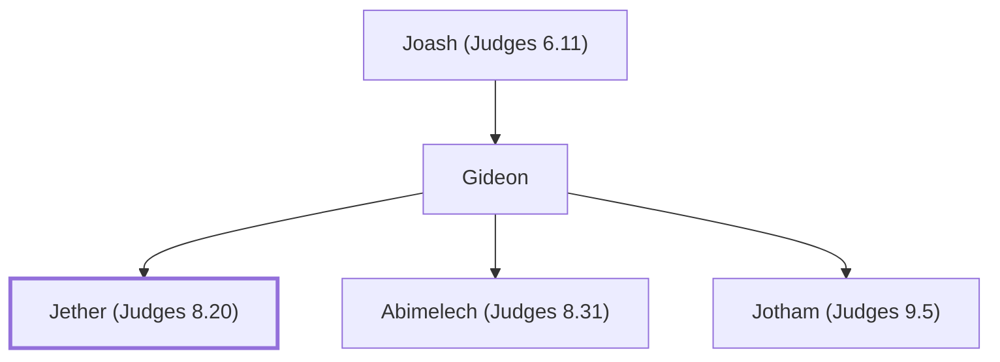

# Jether (Judges 8.20)

Gideon's firstborn son who refused to kill captives.

**Original-language names:** יֶ֫תֶר (H3500)

## When

- **Placed around:** [[connections/timeline/13th century BC|1245 BC]] *(Ussher: the median date of the passages naming them)*

## Family

- **Father:** [[connections/people/Gideon|Gideon]]
- **Brothers and sisters:** [[connections/people/Abimelech (Judges 8.31)|Abimelech (Judges 8.31)]], [[connections/people/Jotham (Judges 9.5)|Jotham (Judges 9.5)]]

**Line of descent** (3 generations, father to son): [[connections/people/Joash (Judges 6.11)|Joash (Judges 6.11)]] → [[connections/people/Gideon|Gideon]] → **Jether (Judges 8.20)**

**Family group:** [[connections/genealogy/Family of Joash (Judges 6.11)|Family of Joash (Judges 6.11)]], generation 3

## Appears in

[[connections/chapters/07-judges/Judges 8|Judges 8]]
