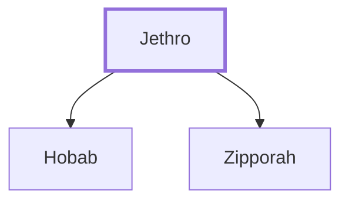

# Jethro

Moses' father-in-law, priest of Midian

**Also called:** Jether, Reuel

**Original-language names:** יִתְרוֹ (H3503) · יֶ֫תֶר (H3500) · רְעוּאֵל (H7467)

## When

- **Placed around:** [[connections/timeline/15th century BC|1491 BC]] *(Ussher: the median date of the passages naming them)*

## Family

- **Children:** [[connections/people/Hobab|Hobab]], [[connections/people/Zipporah|Zipporah]]
- **Tribe or nation:** Midian

**Family group:** [[connections/genealogy/Family of Adam|Family of Adam]], generation 1

## Appears in

[[connections/chapters/02-exodus/Exodus 2|Exodus 2]] · [[connections/chapters/02-exodus/Exodus 3|Exodus 3]] · [[connections/chapters/02-exodus/Exodus 4|Exodus 4]] · [[connections/chapters/02-exodus/Exodus 18|Exodus 18 (7)]] · [[connections/chapters/04-numbers/Numbers 10|Numbers 10]]

## Appears in the same verse as

[[connections/people/Moses|Moses (8)]] · [[connections/people/Israel|Israel (4)]] · [[connections/places/Egypt|Egypt (4)]] · [[connections/places/Midian|Midian (2)]] · [[connections/people/Aaron|Aaron]] · [[connections/people/Hobab|Hobab]] · [[connections/people/Pharaoh (Exodus 3.10)|Pharaoh (Exodus 3.10)]] · [[connections/people/Zipporah|Zipporah]] · [[connections/places/Sinai|Sinai]]
