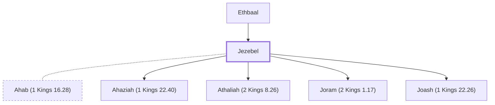

# Jezebel

Queen of Israel; wife of King Ahab

**Original-language names:** אִיזֶבֶל (H0348) · Ἰεζαβήλ (G2403)

## When

- **Placed around:** [[connections/timeline/9th century BC|899 BC]] *(Ussher: the median date of the passages naming them)*

## Family

- **Father:** [[connections/people/Ethbaal|Ethbaal]]
- **Spouses:** [[connections/people/Ahab (1 Kings 16.28)|Ahab (1 Kings 16.28)]]
- **Children:** [[connections/people/Ahaziah (1 Kings 22.40)|Ahaziah (1 Kings 22.40)]], [[connections/people/Athaliah (2 Kings 8.26)|Athaliah (2 Kings 8.26) (uncertain)]], [[connections/people/Joram (2 Kings 1.17)|Joram (2 Kings 1.17)]], [[connections/people/Joash (1 Kings 22.26)|Joash (1 Kings 22.26) (uncertain)]]
- **Tribe or nation:** Israel

**Family group:** [[connections/genealogy/Family of Adam|Family of Adam]], generation 2

## Appears in

[[connections/chapters/11-1-kings/1 Kings 16|1 Kings 16]] · [[connections/chapters/11-1-kings/1 Kings 18|1 Kings 18 (3)]] · [[connections/chapters/11-1-kings/1 Kings 19|1 Kings 19 (2)]] · [[connections/chapters/11-1-kings/1 Kings 21|1 Kings 21 (7)]] · [[connections/chapters/12-2-kings/2 Kings 9|2 Kings 9 (6)]] · [[connections/chapters/66-revelation/Revelation 2|Revelation 2]]

## Appears in the same verse as

[[connections/places/Jezreel (Joshua 19.18)|Jezreel (Joshua 19.18) (5)]] · [[connections/people/Ahab (1 Kings 16.28)|Ahab (1 Kings 16.28) (4)]] · [[connections/people/Elijah (1 Kings 17.1)|Elijah (1 Kings 17.1) (3)]] · [[connections/people/Naboth|Naboth (3)]] · [[connections/people/Israel|Israel (2)]] · [[connections/people/Jehu (1 Kings 19.16)|Jehu (1 Kings 19.16) (2)]] · [[connections/people/Ethbaal|Ethbaal]] · [[connections/people/Jeroboam (1 Kings 11.26)|Jeroboam (1 Kings 11.26)]] · [[connections/people/Joram (2 Kings 1.17)|Joram (2 Kings 1.17)]] · [[connections/people/Nebat|Nebat]] · [[connections/people/Obadiah (1 Kings 18.3)|Obadiah (1 Kings 18.3)]] · [[connections/places/Carmel Mount|Carmel Mount]]
