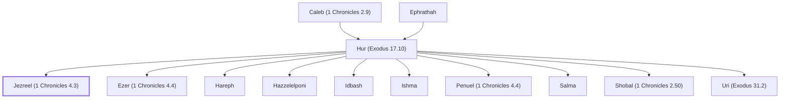

# Jezreel (1 Chronicles 4.3)

A son of Hur in the genealogy of Judah

**Original-language names:** יִזְרְעֶאל (H3157)

## When

- **Placed around:** [[connections/timeline/18th century BC|1721 BC]] *(Ussher: the median date of the passages naming them)*

## Family

- **Father:** [[connections/people/Hur (Exodus 17.10)|Hur (Exodus 17.10) (uncertain)]]
- **Brothers and sisters:** [[connections/people/Ezer (1 Chronicles 4.4)|Ezer (1 Chronicles 4.4)]], [[connections/people/Hareph|Hareph]], [[connections/people/Hazzelelponi|Hazzelelponi]], [[connections/people/Idbash|Idbash]], [[connections/people/Ishma|Ishma]], [[connections/people/Penuel (1 Chronicles 4.4)|Penuel (1 Chronicles 4.4)]], [[connections/people/Salma|Salma]], [[connections/people/Shobal (1 Chronicles 2.50)|Shobal (1 Chronicles 2.50)]], [[connections/people/Uri (Exodus 31.2)|Uri (Exodus 31.2)]]
- **Tribe or nation:** Tribe of Judah

**Line of descent** (29 generations, father to son): [[connections/people/Adam|Adam]] → [[connections/people/Seth|Seth]] → [[connections/people/Enosh|Enosh]] → [[connections/people/Kenan|Kenan]] → [[connections/people/Mahalalel (Genesis 5.12)|Mahalalel (Genesis 5.12)]] → [[connections/people/Jared|Jared]] → [[connections/people/Enoch (Genesis 5.18)|Enoch (Genesis 5.18)]] → [[connections/people/Methuselah|Methuselah]] → [[connections/people/Lamech (Genesis 5.25)|Lamech (Genesis 5.25)]] → [[connections/people/Noah (Genesis 5.29)|Noah (Genesis 5.29)]] → [[connections/people/Shem|Shem]] → [[connections/people/Arpachshad|Arpachshad]] → [[connections/people/Cainan|Cainan]] → [[connections/people/Shelah (Genesis 10.24)|Shelah (Genesis 10.24)]] → [[connections/people/Eber (Genesis 10.21)|Eber (Genesis 10.21)]] → [[connections/people/Peleg|Peleg]] → [[connections/people/Reu|Reu]] → [[connections/people/Serug|Serug]] → [[connections/people/Nahor (Genesis 11.22)|Nahor (Genesis 11.22)]] → [[connections/people/Terah|Terah]] → [[connections/people/Abraham|Abraham]] → [[connections/people/Isaac|Isaac]] → [[connections/people/Israel|Israel]] → [[connections/people/Judah (Genesis 29.35)|Judah (Genesis 29.35)]] → [[connections/people/Perez|Perez]] → [[connections/people/Hezron (Genesis 46.12)|Hezron (Genesis 46.12)]] → [[connections/people/Caleb (1 Chronicles 2.9)|Caleb (1 Chronicles 2.9)]] → [[connections/people/Hur (Exodus 17.10)|Hur (Exodus 17.10)]] → **Jezreel (1 Chronicles 4.3)**

**Family group:** [[connections/genealogy/Family of Adam|Family of Adam]], generation 29

## Appears in

[[connections/chapters/13-1-chronicles/1 Chronicles 4|1 Chronicles 4]]

## Appears in the same verse as

[[connections/people/Hazzelelponi|Hazzelelponi]] · [[connections/people/Idbash|Idbash]] · [[connections/people/Ishma|Ishma]] · [[connections/places/Etam (1 Chronicles 4.3)|Etam (1 Chronicles 4.3)]]
