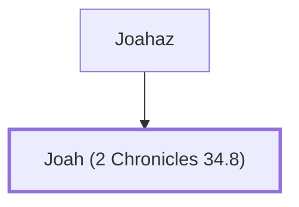

# Joah (2 Chronicles 34.8)

Son of Joahaz, King Josiah's secretary

**Original-language names:** יוֹאָח (H3098)

## When

- **Placed around:** [[connections/timeline/7th century BC|624 BC]] *(Ussher: the median date of the passages naming them)*

## Family

- **Father:** [[connections/people/Joahaz|Joahaz]]

**Family group:** [[connections/genealogy/Family of Joahaz|Family of Joahaz]], generation 2

## Appears in

[[connections/chapters/14-2-chronicles/2 Chronicles 34|2 Chronicles 34]]

## Appears in the same verse as

[[connections/people/Azaliah|Azaliah]] · [[connections/people/Joahaz|Joahaz]] · [[connections/people/Maaseiah (2 Chronicles 34.8)|Maaseiah (2 Chronicles 34.8)]] · [[connections/people/Shaphan (2 Kings 22.3)|Shaphan (2 Kings 22.3)]]
