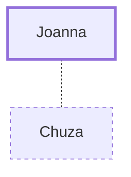

# Joanna

A follower of Jesus who supported His ministry

**Original-language names:** Ἰωάννα, Ἰωανάν (G2489)

## When

- **Placed around:** [[connections/timeline/1st century AD|AD 33]] *(Ussher: the median date of the passages naming them)*

## Family

- **Spouses:** [[connections/people/Chuza|Chuza]]

## Events

- [[connections/timeline/1st century AD|AD 28]] · [[connections/events/Jesus' 2nd Tour of Galilee|Jesus' 2nd Tour of Galilee]]

## Appears in

[[connections/chapters/42-luke/Luke 8|Luke 8]] · [[connections/chapters/42-luke/Luke 24|Luke 24]]

## Appears in the same verse as

[[connections/people/Chuza|Chuza]] · [[connections/people/Herod (Matthew 14.1)|Herod (Matthew 14.1)]] · [[connections/people/James (Matthew 10.3)|James (Matthew 10.3)]] · [[connections/people/Mary (Matthew 27.56)|Mary (Matthew 27.56)]] · [[connections/people/Mary Magdalene|Mary Magdalene]] · [[connections/people/Susanna|Susanna]] · [[connections/places/Magadan|Magadan]]
