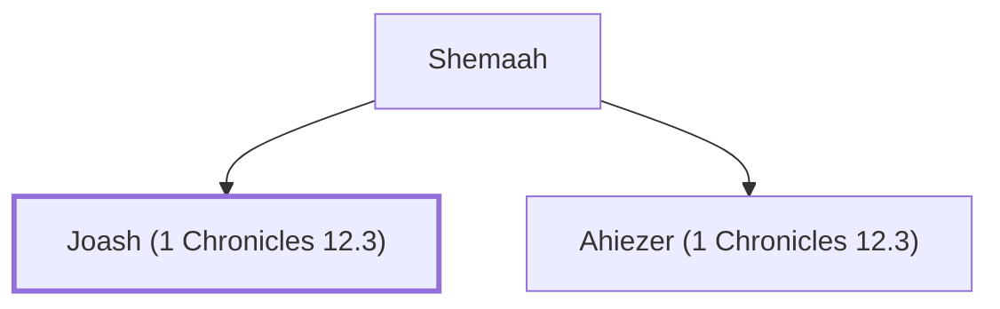

# Joash (1 Chronicles 12.3)

A Benjaminite warrior who joined David at Ziklag

**Original-language names:** יוֹאָשׁ (H3101)

## Family

- **Father:** [[connections/people/Shemaah|Shemaah]]
- **Brothers and sisters:** [[connections/people/Ahiezer (1 Chronicles 12.3)|Ahiezer (1 Chronicles 12.3)]]

**Family group:** [[connections/genealogy/Family of Shemaah|Family of Shemaah]], generation 2

## Appears in

[[connections/chapters/13-1-chronicles/1 Chronicles 12|1 Chronicles 12]]

## Appears in the same verse as

[[connections/people/Ahiezer (1 Chronicles 12.3)|Ahiezer (1 Chronicles 12.3)]] · [[connections/people/Azmaveth (1 Chronicles 12.3)|Azmaveth (1 Chronicles 12.3)]] · [[connections/people/Beracah|Beracah]] · [[connections/people/Jehu (1 Chronicles 12.3)|Jehu (1 Chronicles 12.3)]] · [[connections/people/Jeziel|Jeziel]] · [[connections/people/Pelet (1 Chronicles 12.3)|Pelet (1 Chronicles 12.3)]] · [[connections/people/Shemaah|Shemaah]]
