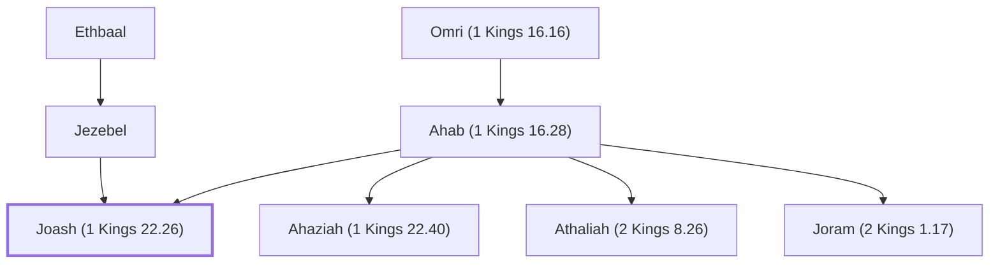

# Joash (1 Kings 22.26)

Son of King Ahab of Israel

**Original-language names:** יוֹאָשׁ (H3101)

## When

- **Placed around:** [[connections/timeline/9th century BC|897 BC]] *(Ussher: the median date of the passages naming them)*

## Family

- **Father:** [[connections/people/Ahab (1 Kings 16.28)|Ahab (1 Kings 16.28)]]
- **Mother:** [[connections/people/Jezebel|Jezebel (uncertain)]]
- **Brothers and sisters:** [[connections/people/Ahaziah (1 Kings 22.40)|Ahaziah (1 Kings 22.40)]], [[connections/people/Athaliah (2 Kings 8.26)|Athaliah (2 Kings 8.26)]], [[connections/people/Joram (2 Kings 1.17)|Joram (2 Kings 1.17)]]
- **Tribe or nation:** Israel

**Line of descent** (3 generations, father to son): [[connections/people/Omri (1 Kings 16.16)|Omri (1 Kings 16.16)]] → [[connections/people/Ahab (1 Kings 16.28)|Ahab (1 Kings 16.28)]] → **Joash (1 Kings 22.26)**

**Family group:** [[connections/genealogy/Family of Adam|Family of Adam]], generation 3

## Appears in

[[connections/chapters/11-1-kings/1 Kings 22|1 Kings 22]] · [[connections/chapters/14-2-chronicles/2 Chronicles 18|2 Chronicles 18]]

## Appears in the same verse as

[[connections/people/Amon (1 Kings 22.26)|Amon (1 Kings 22.26) (2)]] · [[connections/people/Israel|Israel (2)]] · [[connections/people/Micaiah (1 Kings 22.8)|Micaiah (1 Kings 22.8) (2)]]
