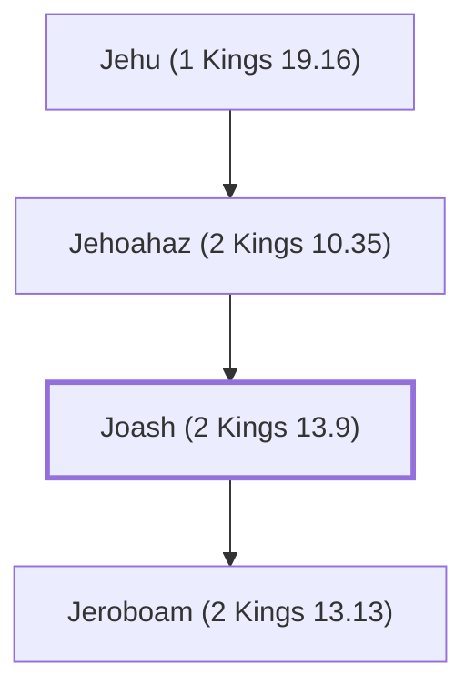

# Joash (2 Kings 13.9)

King of Israel, son of Jehoahaz

**Also called:** Jehoash

**Original-language names:** יוֹאָשׁ (H3101) · יְהוֹאָשׁ (H3060)

## When

- **Placed around:** [[connections/timeline/9th century BC|826 BC]] *(Ussher: the median date of the passages naming them)*

## Family

- **Father:** [[connections/people/Jehoahaz (2 Kings 10.35)|Jehoahaz (2 Kings 10.35)]]
- **Children:** [[connections/people/Jeroboam (2 Kings 13.13)|Jeroboam (2 Kings 13.13)]]
- **Tribe or nation:** Israel

**Line of descent** (5 generations, father to son): [[connections/people/Nimshi|Nimshi]] → [[connections/people/Jehoshaphat (2 Kings 9.2)|Jehoshaphat (2 Kings 9.2)]] → [[connections/people/Jehu (1 Kings 19.16)|Jehu (1 Kings 19.16)]] → [[connections/people/Jehoahaz (2 Kings 10.35)|Jehoahaz (2 Kings 10.35)]] → **Joash (2 Kings 13.9)**

**Family group:** [[connections/genealogy/Family of Nimshi|Family of Nimshi]], generation 5

## Events

- [[connections/timeline/9th century BC|840 BC]] · [[connections/events/Reign of Jehoash|Reign of Jehoash]]
- [[connections/timeline/9th century BC|825 BC]] · [[connections/events/Death of Jehoahash|Death of Jehoahash]]

## Appears in

[[connections/chapters/12-2-kings/2 Kings 13|2 Kings 13 (6)]] · [[connections/chapters/12-2-kings/2 Kings 14|2 Kings 14 (10)]] · [[connections/chapters/14-2-chronicles/2 Chronicles 25|2 Chronicles 25 (5)]] · [[connections/chapters/28-hosea/Hosea 1|Hosea 1]] · [[connections/chapters/30-amos/Amos 1|Amos 1]]

## Appears in the same verse as

[[connections/people/Israel|Israel (22)]] · [[connections/people/Judah (Genesis 29.35)|Judah (Genesis 29.35) (16)]] · [[connections/people/Amaziah (2 Kings 12.22)|Amaziah (2 Kings 12.22) (14)]] · [[connections/people/Jehoahaz (2 Kings 10.35)|Jehoahaz (2 Kings 10.35) (8)]] · [[connections/people/Joash (2 Kings 11.2)|Joash (2 Kings 11.2) (7)]] · [[connections/people/Jeroboam (2 Kings 13.13)|Jeroboam (2 Kings 13.13) (6)]] · [[connections/places/Samaria|Samaria (5)]] · [[connections/places/Beth-shemesh (Joshua 15.10)|Beth-shemesh (Joshua 15.10) (4)]] · [[connections/people/Ahaziah (2 Kings 8.24)|Ahaziah (2 Kings 8.24) (2)]] · [[connections/people/Jehu (1 Kings 19.16)|Jehu (1 Kings 19.16) (2)]] · [[connections/people/Uzziah (2 Kings 14.21)|Uzziah (2 Kings 14.21) (2)]] · [[connections/places/Corner Gate|Corner Gate (2)]] · [[connections/places/Ephraim Gate|Ephraim Gate (2)]] · [[connections/places/Jerusalem|Jerusalem (2)]] · [[connections/places/Lebanon|Lebanon (2)]] · [[connections/people/Ahaz (2 Kings 15.38)|Ahaz (2 Kings 15.38)]] · [[connections/people/Amos (Amos 1.1)|Amos (Amos 1.1)]] · [[connections/people/Beeri (Hosea 1.1)|Beeri (Hosea 1.1)]] · [[connections/people/Ben-hadad (2 Kings 13.3)|Ben-hadad (2 Kings 13.3)]] · [[connections/people/Elisha|Elisha]] · [[connections/people/Hazael|Hazael]] · [[connections/people/Hezekiah (2 Kings 16.20)|Hezekiah (2 Kings 16.20)]] · [[connections/people/Hosea|Hosea]] · [[connections/people/Jotham (2 Kings 15.5)|Jotham (2 Kings 15.5)]] · [[connections/places/Tekoa|Tekoa]]
