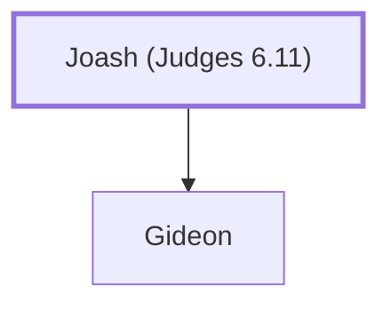

# Joash (Judges 6.11)

The father of Gideon, a judge of Israel

**Original-language names:** יוֹאָשׁ (H3101)

## When

- **Placed around:** [[connections/timeline/13th century BC|1245 BC]] *(Ussher: the median date of the passages naming them)*

## Family

- **Children:** [[connections/people/Gideon|Gideon]]

**Family group:** [[connections/genealogy/Family of Joash (Judges 6.11)|Family of Joash (Judges 6.11)]], generation 1

## Appears in

[[connections/chapters/07-judges/Judges 6|Judges 6 (4)]] · [[connections/chapters/07-judges/Judges 7|Judges 7]] · [[connections/chapters/07-judges/Judges 8|Judges 8 (3)]]

## Appears in the same verse as

[[connections/people/Gideon|Gideon (6)]] · [[connections/places/Midian|Midian (2)]] · [[connections/places/Ophrah (Joshua 19.19)|Ophrah (Joshua 19.19) (2)]] · [[connections/people/Israel|Israel]] · [[connections/places/Heres|Heres]]
