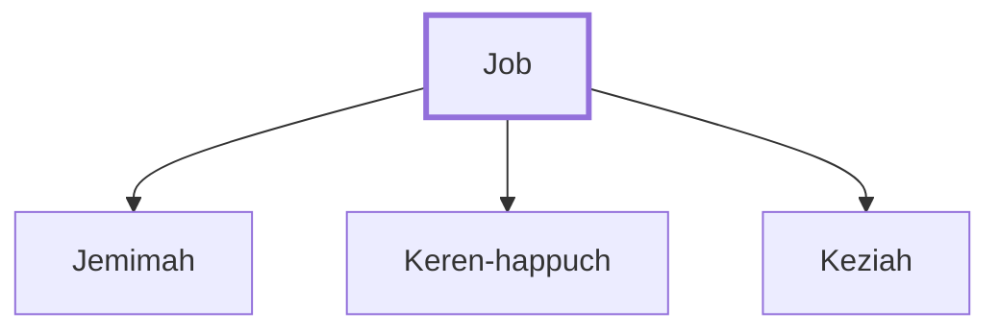

# Job

A righteous man who endured great suffering

**Original-language names:** אִיּוֹב (H0347) · Ἰώβ (G2492)

## When

- **Lived:** [[connections/timeline/18th century BC|1720 BC]] – [[connections/timeline/16th century BC|1580 BC]] *(Jones)*
- **Placed around:** [[connections/timeline/16th century BC|1520 BC]] *(Ussher: the median date of the passages naming them)*

## Family

- **Children:** [[connections/people/Jemimah|Jemimah]], [[connections/people/Keren-happuch|Keren-happuch]], [[connections/people/Keziah|Keziah]]

**Family group:** [[connections/genealogy/Family of Job|Family of Job]], generation 1

## Events

- [[connections/timeline/18th century BC|1720 BC]] · [[connections/events/Birth of Job|Birth of Job]]
- [[connections/timeline/18th century BC|1720 BC]] · [[connections/events/Lifetime of Job|Lifetime of Job]]
- [[connections/timeline/17th century BC|1650 BC]] · [[connections/events/Job's Trial|Job's Trial]]
- [[connections/timeline/16th century BC|1580 BC]] · [[connections/events/Death of Job|Death of Job]]

## Appears in

[[connections/chapters/18-job/Job 1|Job 1 (7)]] · [[connections/chapters/18-job/Job 2|Job 2 (4)]] · [[connections/chapters/18-job/Job 3|Job 3 (2)]] · [[connections/chapters/18-job/Job 6|Job 6]] · [[connections/chapters/18-job/Job 9|Job 9]] · [[connections/chapters/18-job/Job 12|Job 12]] · [[connections/chapters/18-job/Job 16|Job 16]] · [[connections/chapters/18-job/Job 19|Job 19]] · [[connections/chapters/18-job/Job 21|Job 21]] · [[connections/chapters/18-job/Job 23|Job 23]] · [[connections/chapters/18-job/Job 26|Job 26]] · [[connections/chapters/18-job/Job 27|Job 27]] · [[connections/chapters/18-job/Job 29|Job 29]] · [[connections/chapters/18-job/Job 31|Job 31]] · [[connections/chapters/18-job/Job 32|Job 32 (5)]] · [[connections/chapters/18-job/Job 33|Job 33 (2)]] · [[connections/chapters/18-job/Job 34|Job 34 (4)]] · [[connections/chapters/18-job/Job 35|Job 35]] · [[connections/chapters/18-job/Job 37|Job 37]] · [[connections/chapters/18-job/Job 38|Job 38]] · [[connections/chapters/18-job/Job 40|Job 40 (3)]] · [[connections/chapters/18-job/Job 42|Job 42 (9)]] · [[connections/chapters/26-ezekiel/Ezekiel 14|Ezekiel 14 (2)]] · [[connections/chapters/59-james/James 5|James 5]]

## Appears in the same verse as

[[connections/people/Eliphaz (Job 2.11)|Eliphaz (Job 2.11) (3)]] · [[connections/people/Bildad|Bildad (2)]] · [[connections/people/Daniel (Ezekiel 14.14)|Daniel (Ezekiel 14.14) (2)]] · [[connections/people/Elihu (Job 32.2)|Elihu (Job 32.2) (2)]] · [[connections/people/Noah (Genesis 5.29)|Noah (Genesis 5.29) (2)]] · [[connections/people/Zophar|Zophar (2)]] · [[connections/people/Barachel|Barachel]] · [[connections/people/Ram (Job 32.2)|Ram (Job 32.2)]] · [[connections/places/Uz|Uz]]
