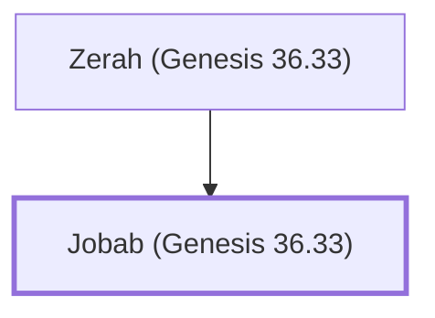

# Jobab (Genesis 36.33)

A king of Edom, son of Zerah of Bozrah

**Original-language names:** יוֹבָב (H3103)

## When

- **Placed around:** [[connections/timeline/19th century BC|1853 BC]] *(Ussher: the median date of the passages naming them)*

## Family

- **Father:** [[connections/people/Zerah (Genesis 36.33)|Zerah (Genesis 36.33)]]
- **Tribe or nation:** Edom

**Family group:** [[connections/genealogy/Family of Zerah (Genesis 36.33)|Family of Zerah (Genesis 36.33)]], generation 2

## Appears in

[[connections/chapters/01-genesis/Genesis 36|Genesis 36 (2)]] · [[connections/chapters/13-1-chronicles/1 Chronicles 1|1 Chronicles 1 (2)]]

## Appears in the same verse as

[[connections/people/Bela (Genesis 36.32)|Bela (Genesis 36.32) (2)]] · [[connections/people/Husham|Husham (2)]] · [[connections/people/Zerah (Genesis 36.33)|Zerah (Genesis 36.33) (2)]] · [[connections/places/Bozrah|Bozrah (2)]]
