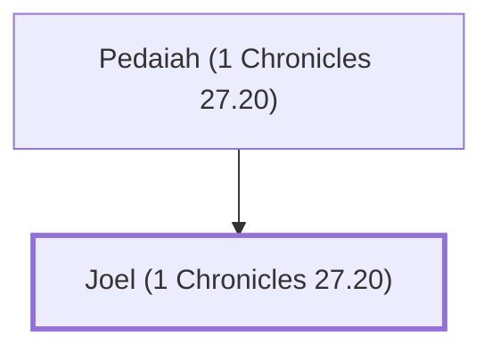

# Joel (1 Chronicles 27.20)

A ruler of the half-tribe of Manasseh in Gilead

**Original-language names:** יוֹאֵל (H3100)

## When

- **Placed around:** [[connections/timeline/11th century BC|1015 BC]] *(Ussher: the median date of the passages naming them)*

## Family

- **Father:** [[connections/people/Pedaiah (1 Chronicles 27.20)|Pedaiah (1 Chronicles 27.20)]]

**Family group:** [[connections/genealogy/Family of Pedaiah (1 Chronicles 27.20)|Family of Pedaiah (1 Chronicles 27.20)]], generation 2

## Appears in

[[connections/chapters/13-1-chronicles/1 Chronicles 27|1 Chronicles 27]]

## Appears in the same verse as

[[connections/people/Azaziah (1 Chronicles 27.20)|Azaziah (1 Chronicles 27.20)]] · [[connections/people/Ephraim|Ephraim]] · [[connections/people/Hoshea (1 Chronicles 27.20)|Hoshea (1 Chronicles 27.20)]] · [[connections/people/Manasseh (Genesis 41.51)|Manasseh (Genesis 41.51)]] · [[connections/people/Pedaiah (1 Chronicles 27.20)|Pedaiah (1 Chronicles 27.20)]]
