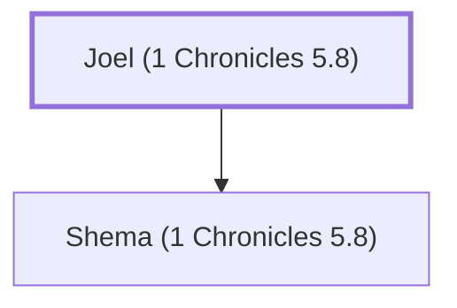

# Joel (1 Chronicles 5.8)

Father of Shema living in Reubenite lands

**Original-language names:** יוֹאֵל (H3100)

## When

- **Placed around:** [[connections/timeline/18th century BC|1710 BC]] *(Ussher: the median date of the passages naming them)*

## Family

- **Children:** [[connections/people/Shema (1 Chronicles 5.8)|Shema (1 Chronicles 5.8)]]
- **Tribe or nation:** Tribe of Reuben

**Family group:** [[connections/genealogy/Family of Joel (1 Chronicles 5.8)|Family of Joel (1 Chronicles 5.8)]], generation 1

## Appears in

[[connections/chapters/13-1-chronicles/1 Chronicles 5|1 Chronicles 5]]

## Appears in the same verse as

[[connections/people/Azaz|Azaz]] · [[connections/people/Bela (1 Chronicles 5.8)|Bela (1 Chronicles 5.8)]] · [[connections/people/Shema (1 Chronicles 5.8)|Shema (1 Chronicles 5.8)]] · [[connections/places/Aroer (Numbers 32.34)|Aroer (Numbers 32.34)]] · [[connections/places/Baal-meon|Baal-meon]] · [[connections/places/Nebo (Numbers 32.3)|Nebo (Numbers 32.3)]]
