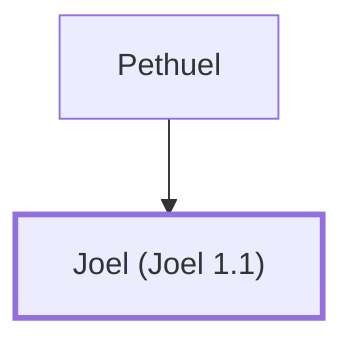

# Joel (Joel 1.1)

A prophet of Judah and the author of the Book of Joel

**Original-language names:** יוֹאֵל (H3100) · Ἰωήλ (G2493)

## When

- **Placed around:** [[connections/timeline/1st century AD|AD 33]] *(Ussher: the median date of the passages naming them)*

## Family

- **Father:** [[connections/people/Pethuel|Pethuel]]

**Family group:** [[connections/genealogy/Family of Pethuel|Family of Pethuel]], generation 2

## Events

- [[connections/timeline/9th century BC|820 BC]] · [[connections/events/Prophecies of Joel|Prophecies of Joel]]

## Appears in

[[connections/chapters/29-joel/Joel 1|Joel 1]] · [[connections/chapters/44-acts/Acts 2|Acts 2]]

## Appears in the same verse as

[[connections/people/Pethuel|Pethuel]]
