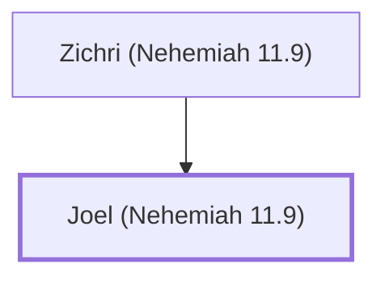

# Joel (Nehemiah 11.9)

A Benjaminite leader in Jerusalem after the Exile

**Original-language names:** יוֹאֵל (H3100)

## When

- **Placed around:** [[connections/timeline/5th century BC|445 BC]] *(Ussher: the median date of the passages naming them)*

## Family

- **Father:** [[connections/people/Zichri (Nehemiah 11.9)|Zichri (Nehemiah 11.9)]]

**Family group:** [[connections/genealogy/Family of Zichri (Nehemiah 11.9)|Family of Zichri (Nehemiah 11.9)]], generation 2

## Appears in

[[connections/chapters/16-nehemiah/Nehemiah 11|Nehemiah 11]]

## Appears in the same verse as

[[connections/people/Judah (Nehemiah 11.9)|Judah (Nehemiah 11.9)]] · [[connections/people/Senaah|Senaah]] · [[connections/people/Zichri (Nehemiah 11.9)|Zichri (Nehemiah 11.9)]]
